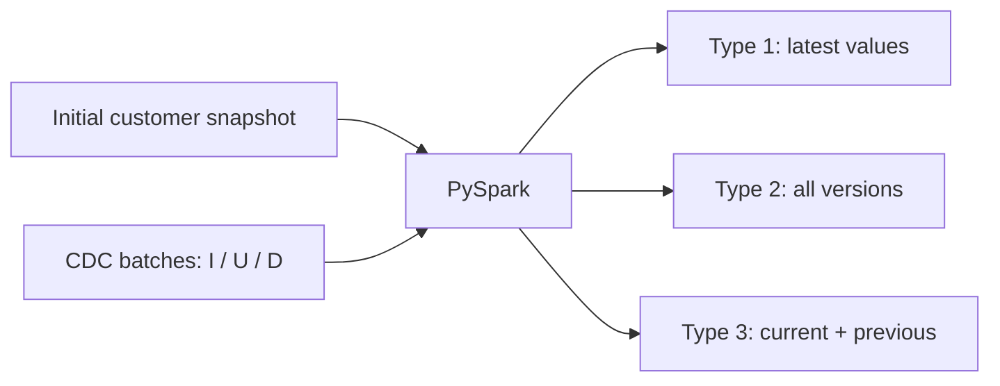
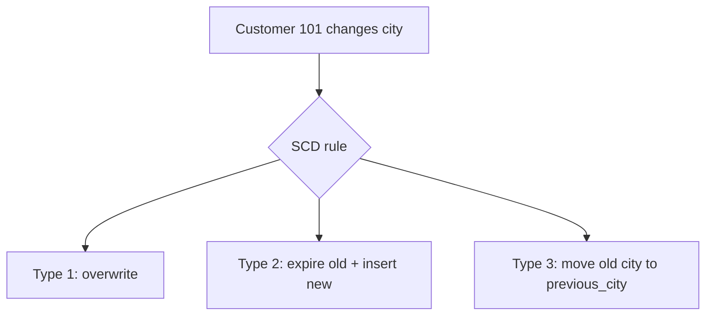
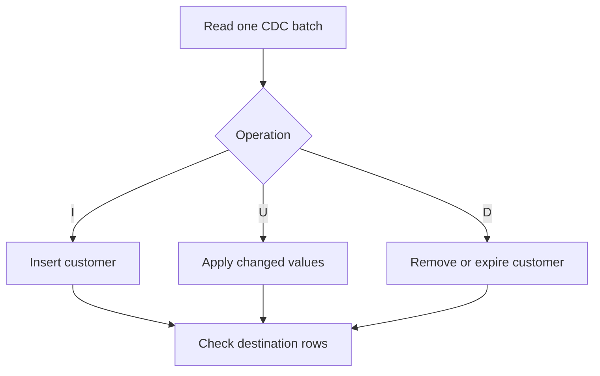

# CDC + Slowly Changing Dimensions (SCD Types 1, 2 and 3)

**Platform:** PySpark shell (`pyspark`)  
**Scenario:** Customer records in an e-commerce system  
**Input:** One initial snapshot, followed by three ordered CDC batches  
**Output:** Three customer dimension tables maintained using SCD Type 1, Type 2 and Type 3

> Run the code **in order**, using the **same PySpark shell**. Every exercise includes runnable code followed by the result to check. A fresh PySpark shell gives the cleanest starting point.

---

## 1. The problem: source data changes over time

A customer may change their city. Reports may need the **latest city** or the **city at the time of an older sale**. Both are valid questions, but they need different data-handling rules.

- **CDC (Change Data Capture):** supplies the rows that were inserted, updated or deleted in a source system.
- **SCD (Slowly Changing Dimension):** decides how to save those changes in an analytical dimension.

**Remember:** CDC tells us **what changed**. SCD tells us **how to store the change**.



### CDC operation codes

| Code | Meaning | CDC record contains |
|---|---|---|
| `I` | Insert | New customer details |
| `U` | Update | Complete new values for that customer (*after image*) |
| `D` | Delete | Customer ID; other columns can be null |

**Rules for this exercise:** The initial snapshot is dated **2026-11-01**. CDC batches are already ordered, validated and deduplicated. Each customer appears at most once in a batch. A customer has at most one change per day. Process each batch **once** and in order. These assumptions keep the focus on SCD logic; production CDC also needs replay protection, ordering, error handling and persistence.

---

## Exercise 1 — Create the initial snapshot

A snapshot is a complete copy of the customer records at a point in time. We start with eight customers.

```python
from pyspark.sql import functions as F

# Snapshot as of 2026-11-01.
initial_rows = [
    (101, "Asha",   "Pune"),
    (102, "Rahul",  "Mumbai"),
    (103, "Meera",  "Delhi"),
    (104, "Vikram", "Chennai"),
    (105, "Neha",   "Hyderabad"),
    (106, "Arjun",  "Kolkata"),
    (107, "Priya",  "Jaipur"),
    (108, "Karan",  "Ahmedabad")
]

initial = spark.createDataFrame(
    initial_rows,
    "customer_id INT, customer_name STRING, city STRING"
)

initial.orderBy("customer_id").show(truncate=False)
initial.count()
```

**Expected:** Eight rows. Customer 101 (Asha) lives in Pune.

### What each SCD type stores

| Type | One-line meaning | If Asha moves from Pune to Mumbai |
|---|---|---|
| **Type 1** | **Keep the latest value.** | Replace Pune with Mumbai |
| **Type 2** | **Keep every recorded version.** | Close Pune's version and add Mumbai |
| **Type 3** | **Keep the current and previous value.** | Current = Mumbai, Previous = Pune |



---

## Exercise 2 — Build the three dimension tables from the snapshot

### SCD Type 1: one row per customer

```python
scd1 = initial.select("customer_id", "customer_name", "city")
scd1.orderBy("customer_id").show(truncate=False)
```

### SCD Type 2: dated versions

- `valid_from`: date this version became valid, **inclusive**.
- `valid_to`: date this version stopped being valid, **exclusive**. Null means it is still valid.
- `is_current`: whether this is the latest active version.

```python
scd2 = initial.withColumn("valid_from", F.to_date(F.lit("2026-11-01")))
scd2 = scd2.withColumn("valid_to", F.lit(None).cast("date"))
scd2 = scd2.withColumn("is_current", F.lit(True))

scd2.orderBy("customer_id").show(truncate=False)
```

Here, `(customer_id, valid_from)` identifies a version in this exercise. A real warehouse may use a separate surrogate dimension key.

### SCD Type 3: one previous city

```python
scd3 = initial.withColumnRenamed("city", "current_city")
scd3 = scd3.withColumn("previous_city", F.lit(None).cast("string"))

scd3.orderBy("customer_id").show(truncate=False)
```

**Expected:** All three dimensions contain eight customers. Type 2 has eight current versions. Type 3 has null `previous_city` values.

---

## 2. CDC batch processing pattern

For each batch, we apply the same three rules:

**Type 1** removes the old row for each changed customer, then adds the latest non-delete row. A delete removes the customer.

**Type 2** keeps older history, closes the current version for updates/deletes, and inserts a fresh version for inserts/updates. A delete does not create a new active row.

**Type 3** replaces the current row for inserts/updates; if the city changed, the previous current city becomes `previous_city`. A delete removes the customer.



---
## Exercise 3 — Process CDC Batch 1 (2026-11-05)

**Changes:** Asha moves Pune → Mumbai; Rahul moves Mumbai → Pune; Diya joins.

### Step A — Read the CDC batch

```python
# Each U/I row contains the new customer values; D uses only customer_id.
cdc1_rows = [
    (101, 'Asha', 'Mumbai', 'U', '2026-11-05'),
    (102, 'Rahul', 'Pune', 'U', '2026-11-05'),
    (109, 'Diya', 'Chennai', 'I', '2026-11-05')
]

cdc1 = spark.createDataFrame(
    cdc1_rows,
    "customer_id INT, customer_name STRING, city STRING, op STRING, event_date STRING"
)

cdc1.orderBy("customer_id").show(truncate=False)
```

**Expected:** Three CDC events with their operation codes and event date.

### Step B — Apply SCD Type 1 (overwrite)

```python
# Remove any existing destination rows mentioned by this CDC batch.
scd1_kept = scd1.join(cdc1.select("customer_id"), "customer_id", "left_anti")

# Insert/update events become the new current rows. Delete events are excluded.
scd1_latest = cdc1.filter(F.col("op").isin("I", "U"))
scd1_latest = scd1_latest.select("customer_id", "customer_name", "city")

scd1 = scd1_kept.unionByName(scd1_latest)
scd1.orderBy("customer_id").show(truncate=False)
```

**What happened:** Each customer has at most one row. Older city values are not available in Type 1.

### Step C — Apply SCD Type 2 (keep history)

```python
# Split old historical versions from active versions.
old_closed = scd2.filter(F.col("is_current") == False)
old_open = scd2.filter(F.col("is_current") == True)

# Updates and deletes must close the previous active version.
close_events = cdc1.filter(F.col("op").isin("U", "D"))
close_events = close_events.select("customer_id", "event_date")
close_events.orderBy("customer_id").show(truncate=False)

# Keep active customers who have no update/delete in this batch.
keep_open = old_open.join(close_events.select("customer_id"), "customer_id", "left_anti")

# End the old active versions on the CDC event date.
close_rows = old_open.join(close_events, "customer_id", "inner")
close_rows = close_rows.withColumn("valid_to", F.to_date("event_date"))
close_rows = close_rows.withColumn("is_current", F.lit(False))
close_rows = close_rows.select("customer_id", "customer_name", "city", "valid_from", "valid_to", "is_current")
close_rows.orderBy("customer_id").show(truncate=False)

# Insert a new active version for I/U events; D creates no new version.
new_versions = cdc1.filter(F.col("op").isin("I", "U"))
new_versions = new_versions.select(
    "customer_id", "customer_name", "city",
    F.to_date("event_date").alias("valid_from"),
    F.lit(None).cast("date").alias("valid_to"),
    F.lit(True).alias("is_current")
)
new_versions.orderBy("customer_id").show(truncate=False)

# Combine existing history, unchanged active rows, expired rows and new versions.
scd2 = old_closed.unionByName(keep_open)
scd2 = scd2.unionByName(close_rows)
scd2 = scd2.unionByName(new_versions)

scd2.filter(F.col("customer_id") == 101).orderBy("valid_from").show(truncate=False)
```

**What happened:** Type 2 preserves each former city and its validity period. On a delete, the last active version is expired but older history is retained.

### Step D — Apply SCD Type 3 (current + previous)

```python
# Keep customers not mentioned by this batch.
scd3_kept = scd3.join(cdc1.select("customer_id"), "customer_id", "left_anti")

# Pair each incoming I/U row with the old Type 3 value, if one exists.
incoming = cdc1.filter(F.col("op").isin("I", "U")).alias("n")
old = scd3.alias("o")
paired = incoming.join(old, F.col("n.customer_id") == F.col("o.customer_id"), "left")

# For a city change, shift the old current city into previous_city.
# For a new customer, previous_city is null.
scd3_latest = paired.select(
    F.col("n.customer_id").alias("customer_id"),
    F.col("n.customer_name").alias("customer_name"),
    F.col("n.city").alias("current_city"),
    F.when(F.col("o.customer_id").isNull(), F.lit(None).cast("string"))
     .when(F.col("n.city") != F.col("o.current_city"), F.col("o.current_city"))
     .otherwise(F.col("o.previous_city")).alias("previous_city")
)

scd3_latest.orderBy("customer_id").show(truncate=False)
scd3 = scd3_kept.unionByName(scd3_latest)
scd3.filter(F.col("customer_id") == 101).show(truncate=False)
```

**What happened:** Type 3 keeps only the latest and immediately previous city, not the full movement history.

### Step E — Verify this batch

```python
scd1.count()
scd2.count()
scd2.filter(F.col("is_current") == True).count()
scd3.count()
```

**Expected:** 9 current customers; 11 Type 2 versions. For 101, Type 2 has Pune and Mumbai. Type 3 shows previous Pune, current Mumbai.

---
## Exercise 4 — Process CDC Batch 2 (2026-11-06)

**Changes:** Asha moves again: Mumbai → Bengaluru; Vikram moves Chennai → Hyderabad; Sameer joins.

### Step A — Read the CDC batch

```python
# Each U/I row contains the new customer values; D uses only customer_id.
cdc2_rows = [
    (101, 'Asha', 'Bengaluru', 'U', '2026-11-06'),
    (104, 'Vikram', 'Hyderabad', 'U', '2026-11-06'),
    (110, 'Sameer', 'Surat', 'I', '2026-11-06')
]

cdc2 = spark.createDataFrame(
    cdc2_rows,
    "customer_id INT, customer_name STRING, city STRING, op STRING, event_date STRING"
)

cdc2.orderBy("customer_id").show(truncate=False)
```

**Expected:** Three CDC events with their operation codes and event date.

### Step B — Apply SCD Type 1 (overwrite)

```python
# Remove any existing destination rows mentioned by this CDC batch.
scd1_kept = scd1.join(cdc2.select("customer_id"), "customer_id", "left_anti")

# Insert/update events become the new current rows. Delete events are excluded.
scd1_latest = cdc2.filter(F.col("op").isin("I", "U"))
scd1_latest = scd1_latest.select("customer_id", "customer_name", "city")

scd1 = scd1_kept.unionByName(scd1_latest)
scd1.orderBy("customer_id").show(truncate=False)
```

**What happened:** Each customer has at most one row. Older city values are not available in Type 1.

### Step C — Apply SCD Type 2 (keep history)

```python
# Split old historical versions from active versions.
old_closed = scd2.filter(F.col("is_current") == False)
old_open = scd2.filter(F.col("is_current") == True)

# Updates and deletes must close the previous active version.
close_events = cdc2.filter(F.col("op").isin("U", "D"))
close_events = close_events.select("customer_id", "event_date")
close_events.orderBy("customer_id").show(truncate=False)

# Keep active customers who have no update/delete in this batch.
keep_open = old_open.join(close_events.select("customer_id"), "customer_id", "left_anti")

# End the old active versions on the CDC event date.
close_rows = old_open.join(close_events, "customer_id", "inner")
close_rows = close_rows.withColumn("valid_to", F.to_date("event_date"))
close_rows = close_rows.withColumn("is_current", F.lit(False))
close_rows = close_rows.select("customer_id", "customer_name", "city", "valid_from", "valid_to", "is_current")
close_rows.orderBy("customer_id").show(truncate=False)

# Insert a new active version for I/U events; D creates no new version.
new_versions = cdc2.filter(F.col("op").isin("I", "U"))
new_versions = new_versions.select(
    "customer_id", "customer_name", "city",
    F.to_date("event_date").alias("valid_from"),
    F.lit(None).cast("date").alias("valid_to"),
    F.lit(True).alias("is_current")
)
new_versions.orderBy("customer_id").show(truncate=False)

# Combine existing history, unchanged active rows, expired rows and new versions.
scd2 = old_closed.unionByName(keep_open)
scd2 = scd2.unionByName(close_rows)
scd2 = scd2.unionByName(new_versions)

scd2.filter(F.col("customer_id") == 101).orderBy("valid_from").show(truncate=False)
```

**What happened:** Type 2 preserves each former city and its validity period. On a delete, the last active version is expired but older history is retained.

### Step D — Apply SCD Type 3 (current + previous)

```python
# Keep customers not mentioned by this batch.
scd3_kept = scd3.join(cdc2.select("customer_id"), "customer_id", "left_anti")

# Pair each incoming I/U row with the old Type 3 value, if one exists.
incoming = cdc2.filter(F.col("op").isin("I", "U")).alias("n")
old = scd3.alias("o")
paired = incoming.join(old, F.col("n.customer_id") == F.col("o.customer_id"), "left")

# For a city change, shift the old current city into previous_city.
# For a new customer, previous_city is null.
scd3_latest = paired.select(
    F.col("n.customer_id").alias("customer_id"),
    F.col("n.customer_name").alias("customer_name"),
    F.col("n.city").alias("current_city"),
    F.when(F.col("o.customer_id").isNull(), F.lit(None).cast("string"))
     .when(F.col("n.city") != F.col("o.current_city"), F.col("o.current_city"))
     .otherwise(F.col("o.previous_city")).alias("previous_city")
)

scd3_latest.orderBy("customer_id").show(truncate=False)
scd3 = scd3_kept.unionByName(scd3_latest)
scd3.filter(F.col("customer_id") == 101).show(truncate=False)
```

**What happened:** Type 3 keeps only the latest and immediately previous city, not the full movement history.

### Step E — Verify this batch

```python
scd1.count()
scd2.count()
scd2.filter(F.col("is_current") == True).count()
scd3.count()
```

**Expected:** 10 current customers; 14 Type 2 versions. For 101, Type 2 has Pune, Mumbai and Bengaluru. Type 3 shows previous Mumbai, current Bengaluru.

---
## Exercise 5 — Process CDC Batch 3 (2026-11-07)

**Changes:** Asha moves again: Bengaluru → Delhi; Meera moves Delhi → Noida; customer 105 is deleted.

### Step A — Read the CDC batch

```python
# Each U/I row contains the new customer values; D uses only customer_id.
cdc3_rows = [
    (101, 'Asha', 'Delhi', 'U', '2026-11-07'),
    (103, 'Meera', 'Noida', 'U', '2026-11-07'),
    (105, None, None, 'D', '2026-11-07')
]

cdc3 = spark.createDataFrame(
    cdc3_rows,
    "customer_id INT, customer_name STRING, city STRING, op STRING, event_date STRING"
)

cdc3.orderBy("customer_id").show(truncate=False)
```

**Expected:** Three CDC events with their operation codes and event date.

### Step B — Apply SCD Type 1 (overwrite)

```python
# Remove any existing destination rows mentioned by this CDC batch.
scd1_kept = scd1.join(cdc3.select("customer_id"), "customer_id", "left_anti")

# Insert/update events become the new current rows. Delete events are excluded.
scd1_latest = cdc3.filter(F.col("op").isin("I", "U"))
scd1_latest = scd1_latest.select("customer_id", "customer_name", "city")

scd1 = scd1_kept.unionByName(scd1_latest)
scd1.orderBy("customer_id").show(truncate=False)
```

**What happened:** Each customer has at most one row. Older city values are not available in Type 1.

### Step C — Apply SCD Type 2 (keep history)

```python
# Split old historical versions from active versions.
old_closed = scd2.filter(F.col("is_current") == False)
old_open = scd2.filter(F.col("is_current") == True)

# Updates and deletes must close the previous active version.
close_events = cdc3.filter(F.col("op").isin("U", "D"))
close_events = close_events.select("customer_id", "event_date")
close_events.orderBy("customer_id").show(truncate=False)

# Keep active customers who have no update/delete in this batch.
keep_open = old_open.join(close_events.select("customer_id"), "customer_id", "left_anti")

# End the old active versions on the CDC event date.
close_rows = old_open.join(close_events, "customer_id", "inner")
close_rows = close_rows.withColumn("valid_to", F.to_date("event_date"))
close_rows = close_rows.withColumn("is_current", F.lit(False))
close_rows = close_rows.select("customer_id", "customer_name", "city", "valid_from", "valid_to", "is_current")
close_rows.orderBy("customer_id").show(truncate=False)

# Insert a new active version for I/U events; D creates no new version.
new_versions = cdc3.filter(F.col("op").isin("I", "U"))
new_versions = new_versions.select(
    "customer_id", "customer_name", "city",
    F.to_date("event_date").alias("valid_from"),
    F.lit(None).cast("date").alias("valid_to"),
    F.lit(True).alias("is_current")
)
new_versions.orderBy("customer_id").show(truncate=False)

# Combine existing history, unchanged active rows, expired rows and new versions.
scd2 = old_closed.unionByName(keep_open)
scd2 = scd2.unionByName(close_rows)
scd2 = scd2.unionByName(new_versions)

scd2.filter(F.col("customer_id") == 101).orderBy("valid_from").show(truncate=False)
```

**What happened:** Type 2 preserves each former city and its validity period. On a delete, the last active version is expired but older history is retained.

### Step D — Apply SCD Type 3 (current + previous)

```python
# Keep customers not mentioned by this batch.
scd3_kept = scd3.join(cdc3.select("customer_id"), "customer_id", "left_anti")

# Pair each incoming I/U row with the old Type 3 value, if one exists.
incoming = cdc3.filter(F.col("op").isin("I", "U")).alias("n")
old = scd3.alias("o")
paired = incoming.join(old, F.col("n.customer_id") == F.col("o.customer_id"), "left")

# For a city change, shift the old current city into previous_city.
# For a new customer, previous_city is null.
scd3_latest = paired.select(
    F.col("n.customer_id").alias("customer_id"),
    F.col("n.customer_name").alias("customer_name"),
    F.col("n.city").alias("current_city"),
    F.when(F.col("o.customer_id").isNull(), F.lit(None).cast("string"))
     .when(F.col("n.city") != F.col("o.current_city"), F.col("o.current_city"))
     .otherwise(F.col("o.previous_city")).alias("previous_city")
)

scd3_latest.orderBy("customer_id").show(truncate=False)
scd3 = scd3_kept.unionByName(scd3_latest)
scd3.filter(F.col("customer_id") == 101).show(truncate=False)
```

**What happened:** Type 3 keeps only the latest and immediately previous city, not the full movement history.

### Step E — Verify this batch

```python
scd1.count()
scd2.count()
scd2.filter(F.col("is_current") == True).count()
scd3.count()
```

**Expected:** 9 current customers; 16 Type 2 versions (7 expired, 9 current). For 101, Type 2 has four cities; Type 3 shows only previous Bengaluru and current Delhi. Customer 105 is absent in Types 1/3 but remains in Type 2 history.

---
## Exercise 6 — Answer a historical sales question

**Question:** Asha placed orders on four different dates. Which city should each order belong to if the report uses the customer's city **on the sale date**?

### Step A — Create a small sales fact dataset

```python
sales_rows = [
    (9001, 101, "2026-11-02", 1200),
    (9002, 101, "2026-11-05", 1500),
    (9003, 101, "2026-11-06", 1800),
    (9004, 101, "2026-11-07",  900),
    (9005, 105, "2026-11-06",  700)
]

sales = spark.createDataFrame(
    sales_rows,
    "sale_id INT, customer_id INT, sale_date STRING, amount INT"
)
sales = sales.withColumn("sale_date", F.to_date("sale_date"))
sales.orderBy("sale_id").show(truncate=False)
```

### Step B — Join sales to Type 1 (latest city)

```python
# Type 1 shows today's city even for older orders.
report_type1 = sales.join(scd1, "customer_id", "left")
report_type1.select("sale_id", "sale_date", "city", "amount").orderBy("sale_id").show(truncate=False)
```

**Expected:** Sales 9001–9004 all show **Delhi**. Sale 9005 has **null city**, because customer 105 was deleted from Type 1.

### Step C — Join sales to Type 2 (city valid on sale date)

```python
# Match by customer AND by the half-open date range [valid_from, valid_to).
s = sales.alias("s")
d = scd2.alias("d")

report_type2 = s.join(
    d,
    (F.col("s.customer_id") == F.col("d.customer_id")) &
    (F.col("s.sale_date") >= F.col("d.valid_from")) &
    (F.col("d.valid_to").isNull() | (F.col("s.sale_date") < F.col("d.valid_to"))),
    "left"
)

report_type2.select(
    F.col("s.sale_id").alias("sale_id"),
    F.col("s.sale_date").alias("sale_date"),
    F.col("d.city").alias("city_at_sale"),
    F.col("s.amount").alias("amount")
).orderBy("sale_id").show(truncate=False)
```

**Expected:**

| Sale ID | Sale date | City at sale | Amount |
|---|---|---|---:|
| 9001 | 2026-11-02 | Pune | 1,200 |
| 9002 | 2026-11-05 | Mumbai | 1,500 |
| 9003 | 2026-11-06 | Bengaluru | 1,800 |
| 9004 | 2026-11-07 | Delhi | 900 |
| 9005 | 2026-11-06 | Hyderabad | 700 |

Even though customer 105 was deleted later, Type 2 still knows their city for the earlier sale.


> The example uses **dates**, with the start included and the end excluded. Real pipelines often use timestamps because several updates can occur on the same day.

---

## Exercise 7 — Check final destination results

```python
# Type 1 and Type 3: 9 active customer records.
print("Type 1 rows:", scd1.count())
print("Type 3 rows:", scd3.count())

# Type 2: 16 total versions, including expired history.
print("Type 2 versions:", scd2.count())
print("Type 2 current:", scd2.filter(F.col("is_current") == True).count())
print("Type 2 expired:", scd2.filter(F.col("is_current") == False).count())

# This must return no rows: each customer should have only one current version.
scd2.filter(F.col("is_current") == True).groupBy("customer_id").count().filter(F.col("count") > 1).show()

# Inspect every saved version for Asha.
scd2.filter(F.col("customer_id") == 101).orderBy("valid_from").show(truncate=False)

# Inspect the delete event for customer 105.
scd1.filter(F.col("customer_id") == 105).show()
scd2.filter(F.col("customer_id") == 105).show(truncate=False)
scd3.filter(F.col("customer_id") == 105).show()
```

**Expected totals:** Type 1 = **9**, Type 3 = **9**; Type 2 = **16** versions (**9 current**, **7 expired**).

**Expected history for customer 101:**

| City | Valid from | Valid to (exclusive) | Current? |
|---|---|---|---|
| Pune | 2026-11-01 | 2026-11-05 | No |
| Mumbai | 2026-11-05 | 2026-11-06 | No |
| Bengaluru | 2026-11-06 | 2026-11-07 | No |
| Delhi | 2026-11-07 | null | Yes |

### What about customer deletion?

- **Type 1:** Customer 105 is removed. A current-state query cannot find the customer.
- **Type 2:** Their final version is expired on 2026-11-07. Their older history stays available.
- **Type 3:** Customer 105 is removed from the active dimension.

These are **the deletion rules chosen for this exercise**. Other systems may keep soft-deleted rows or tombstones.

---

## Optional Exercise 8 — Save destination tables in MySQL

The SCD transformations above are complete inside the PySpark shell. To store the results in MySQL, first create an empty database in MySQL 8:

```sql
CREATE DATABASE IF NOT EXISTS scd_target_lab;
```

Make sure **MySQL Connector/J** is available to the running Spark session. For a new PySpark shell, the connector can be loaded at startup, for example using `pyspark --jars /path/to/mysql-connector-j.jar`. Replace the JDBC credentials below with credentials for the local practice database.

```python
# Destination only: CDC input is already in Spark, not read from MySQL.
jdbc_url = "jdbc:mysql://localhost:3306/scd_target_lab"
jdbc_user = "YOUR_MYSQL_USER"
jdbc_password = "YOUR_MYSQL_PASSWORD"

scd1.write.format("jdbc").option("url", jdbc_url).option("dbtable", "dim_customer_type1").option("user", jdbc_user).option("password", jdbc_password).option("driver", "com.mysql.cj.jdbc.Driver").mode("overwrite").save()

scd2.write.format("jdbc").option("url", jdbc_url).option("dbtable", "dim_customer_type2").option("user", jdbc_user).option("password", jdbc_password).option("driver", "com.mysql.cj.jdbc.Driver").mode("overwrite").save()

scd3.write.format("jdbc").option("url", jdbc_url).option("dbtable", "dim_customer_type3").option("user", jdbc_user).option("password", jdbc_password).option("driver", "com.mysql.cj.jdbc.Driver").mode("overwrite").save()
```

Check the results in MySQL Workbench:

```sql
USE scd_target_lab;

SELECT COUNT(*) AS type1_rows FROM dim_customer_type1;
SELECT COUNT(*) AS type2_versions FROM dim_customer_type2;
SELECT COUNT(*) AS type3_rows FROM dim_customer_type3;

SELECT customer_id, customer_name, city, valid_from, valid_to, is_current
FROM dim_customer_type2
WHERE customer_id = 101
ORDER BY valid_from;
```

**Important:** `mode("overwrite")` replaces each destination table. It is only for this small practice database. Production pipelines normally use a staging table and controlled inserts/updates (for example, database `MERGE`/upsert where supported), with transaction and recovery handling. Avoid storing production passwords in code.

---

## Final comparison

| Question | Type 1 | Type 2 | Type 3 |
|---|---|---|---|
| Keeps latest city? | Yes | Yes, on current version | Yes |
| Keeps all previous cities? | No | **Yes** | No |
| Keeps one previous city? | No | Included in full history | **Yes** |
| City change action | Overwrite row | Close old + insert new version | Shift current to previous |
| Current active customer count | 9 | 9 | 9 |
| Total dimension rows after batches | 9 | **16** | 9 |
| Supports city-at-sale-date reports? | No, not reliably | **Yes** | Generally no |

### Five key points

1. **CDC is an input of changes; SCD is a storage rule.**
2. **Type 1:** Keep the latest value.
3. **Type 2:** Keep a dated version of every change.
4. **Type 3:** Keep the latest and immediately previous value.
5. **Historical reporting needs an explicit time rule.** In this exercise, Type 2 uses `valid_from <= sale_date < valid_to` (or a null end date).

### Practical limits of this exercise

The CDC batches are already in order and contain one final after-image per customer per batch. The simple transformations do not implement out-of-order event recovery, repeated-batch protection, multiple changes on the same day, or transaction-safe database writes. These are separate pipeline-design concerns, not changes to the definitions of SCD Types 1–3.
