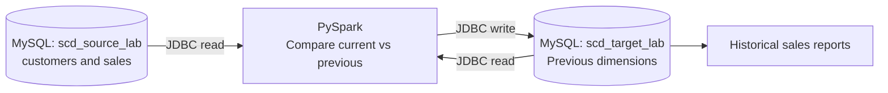
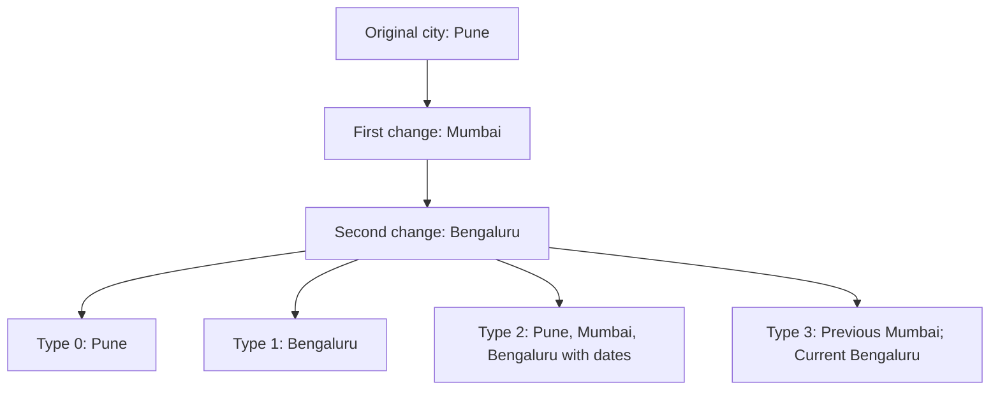
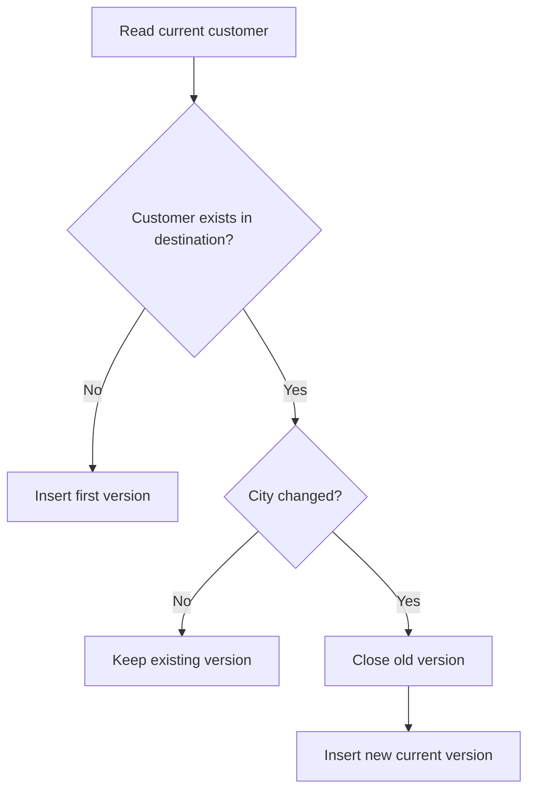
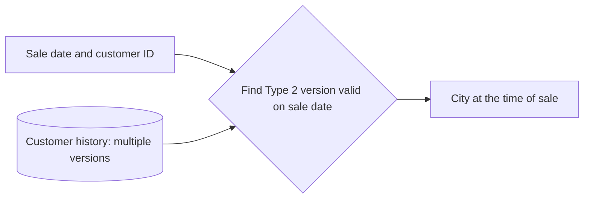

# Slowly Changing Dimensions (SCD) — MySQL to PySpark to MySQL

**Technology:** MySQL 8 and PySpark (interactive shell)  
**Scenario:** An online store tracks customer city changes.  
**Databases:** `scd_source_lab` (operational) and `scd_target_lab` (analytical)

**Learning goal:** Change customer data in the source MySQL database, let PySpark process the change, and inspect how different SCD types store it in the destination MySQL database.

---

## Run order

| Step | Where to run it | What happens |
|---|---|---|
| 1 | MySQL Workbench | Create two databases and insert sample data |
| 2 | Terminal, then PySpark shell | Load the MySQL JDBC driver and connect to both databases |
| 3 | PySpark shell | Define the SCD processing function |
| 4 | PySpark shell + MySQL Workbench | Run the initial batch and verify it |
| 5 | MySQL Workbench → PySpark → MySQL Workbench | Change source data and inspect all SCD types |
| 6 | MySQL Workbench → PySpark → MySQL Workbench | Change a city again and inspect history |
| 7–8 | MySQL Workbench / PySpark | Compare historical reports and confirm repeatability |

**Run SQL statements in order.** A SQL block can be executed one statement at a time in the same MySQL Workbench connection. Run Python statements in the **same PySpark shell** throughout the session. Do not rerun the database setup after you begin processing batches.

## What you will build

A store keeps its **current customer details** in an operational database. PySpark reads those details, applies SCD rules, and writes four customer dimensions into a separate analytical database.

**SCD (Slowly Changing Dimension)** means deciding what to do with an existing descriptive value when that value changes. For example, if Riya moves from Pune to Mumbai, should an old sales report still show Pune?



| Type | One-line meaning | Table in the destination |
|---|---|---|
| **0** | Keep the original city; never replace it. | `dim_customer_type0` |
| **1** | Replace the old city with the latest city. | `dim_customer_type1` |
| **2** | Add a new version of the customer; keep the old version. | `dim_customer_type2` |
| **3** | Keep the latest city and only the previous city. | `dim_customer_type3` |

**Business rules:** Customer ID never changes, names do not change, and only the **city** is tracked. Customers are not deleted during these exercises. Each batch represents changes effective on its stated **date** (one change per customer per day).

**Important:** The source contains only the latest city. The destination controls how much history to keep. Commit source changes in MySQL **before** running Spark: the Spark JDBC connection cannot see uncommitted changes in another connection.

### What happens when Riya moves twice?



---

## Exercise 1 — Create the source and destination databases

### Concept

The **source** is the operational database. It holds the latest customer records and sales. The **destination** is the analytical database. It will preserve or replace customer details according to each SCD type.

### Task

Create both databases and add sample customers and sales to the source. The destination starts with empty dimension tables.

### SQL solution — run in MySQL Workbench

> These names are reserved for the practice exercise. The `DROP DATABASE` statements **delete previous practice data** in these two databases. Never run them against production databases.

```sql
DROP DATABASE IF EXISTS scd_source_lab;
DROP DATABASE IF EXISTS scd_target_lab;

CREATE DATABASE scd_source_lab;
CREATE DATABASE scd_target_lab;

CREATE TABLE scd_source_lab.customers (
    customer_id INT PRIMARY KEY,
    customer_name VARCHAR(40) NOT NULL,
    city VARCHAR(40) NOT NULL
) ENGINE = InnoDB;

CREATE TABLE scd_source_lab.sales (
    sale_id INT PRIMARY KEY,
    customer_id INT NOT NULL,
    sale_date DATE NOT NULL,
    amount DECIMAL(10, 2) NOT NULL,
    FOREIGN KEY (customer_id)
        REFERENCES scd_source_lab.customers(customer_id)
) ENGINE = InnoDB;

INSERT INTO scd_source_lab.customers
    (customer_id, customer_name, city)
VALUES
    (1, 'Riya', 'Pune'),
    (2, 'Amit', 'Mumbai'),
    (3, 'Neha', 'Delhi'),
    (4, 'Rahul', 'Bengaluru'),
    (5, 'Sara', 'Chennai'),
    (6, 'Vikram', 'Hyderabad'),
    (7, 'Priya', 'Jaipur'),
    (8, 'Kiran', 'Kolkata');

INSERT INTO scd_source_lab.sales
    (sale_id, customer_id, sale_date, amount)
VALUES
    (2001, 1, '2026-11-02', 1000.00),
    (2002, 2, '2026-11-02', 1500.00),
    (2003, 3, '2026-11-02', 700.00),
    (2004, 4, '2026-11-02', 2100.00),
    (2005, 5, '2026-11-02', 500.00),
    (2006, 6, '2026-11-02', 1200.00),
    (2007, 7, '2026-11-02', 800.00),
    (2008, 8, '2026-11-02', 600.00),
    (2009, 1, '2026-11-02', 350.00),
    (2010, 2, '2026-11-02', 600.00),
    (2011, 3, '2026-11-02', 400.00),
    (2012, 4, '2026-11-02', 250.00);

COMMIT;

CREATE TABLE scd_target_lab.dim_customer_type0 (
    customer_id INT PRIMARY KEY,
    customer_name VARCHAR(40) NOT NULL,
    original_city VARCHAR(40) NOT NULL
) ENGINE = InnoDB;

CREATE TABLE scd_target_lab.dim_customer_type1 (
    customer_id INT PRIMARY KEY,
    customer_name VARCHAR(40) NOT NULL,
    current_city VARCHAR(40) NOT NULL
) ENGINE = InnoDB;

CREATE TABLE scd_target_lab.dim_customer_type2 (
    customer_sk BIGINT PRIMARY KEY,
    customer_id INT NOT NULL,
    customer_name VARCHAR(40) NOT NULL,
    city VARCHAR(40) NOT NULL,
    valid_from DATE NOT NULL,
    valid_to DATE NULL,
    is_current TINYINT NOT NULL
) ENGINE = InnoDB;

CREATE TABLE scd_target_lab.dim_customer_type3 (
    customer_id INT PRIMARY KEY,
    customer_name VARCHAR(40) NOT NULL,
    previous_city VARCHAR(40) NULL,
    current_city VARCHAR(40) NOT NULL
) ENGINE = InnoDB;

SELECT COUNT(*) AS customers FROM scd_source_lab.customers;
SELECT COUNT(*) AS sales FROM scd_source_lab.sales;
SELECT COUNT(*) AS destination_rows
FROM scd_target_lab.dim_customer_type2;
```

### Expected results

- Source: **8 customers**, **12 sales**.
- Destination Type 2: **0 rows**.
- All four destination tables exist but are empty.

---

## Exercise 2 — Connect PySpark to both MySQL databases

### Concept

**JDBC** lets Spark read and write MySQL tables. The MySQL Connector/J driver must be available when starting PySpark.

### Task

Start PySpark, connect to the source, and check the customer records.

### Commands — PowerShell or terminal

If the JDBC driver is not installed locally, start PySpark using Maven:

```powershell
pyspark --packages com.mysql:mysql-connector-j:9.7.0
```

If the driver JAR is already downloaded, use its **actual path** instead:

```powershell
pyspark --jars "C:\path\to\mysql-connector-j-9.7.0.jar"
```

Run **one** of the commands above, not both. The package option needs internet access on the first run. The example assumes MySQL is running on the same computer, at `127.0.0.1:3306`.

### PySpark solution — run in the PySpark shell

```python
from getpass import getpass
from pyspark.sql import functions as F, Window

mysql_user = input("MySQL user: ")
mysql_password = getpass("MySQL password: ")

source_url = (
    "jdbc:mysql://127.0.0.1:3306/scd_source_lab"
    "?sslMode=DISABLED&allowPublicKeyRetrieval=true&tinyInt1isBit=false"
)

target_url = (
    "jdbc:mysql://127.0.0.1:3306/scd_target_lab"
    "?sslMode=DISABLED&allowPublicKeyRetrieval=true&tinyInt1isBit=false"
)

jdbc_options = {
    "user": mysql_user,
    "password": mysql_password,
    "driver": "com.mysql.cj.jdbc.Driver"
}

source_customers = (
    spark.read.format("jdbc")
    .option("url", source_url)
    .option("dbtable", "customers")
    .options(**jdbc_options)
    .load()
)

source_customers.orderBy("customer_id").show(truncate=False)
```

### Expected result

Eight customer rows. Customer `1` is **Riya — Pune** and customer `2` is **Amit — Mumbai**.

> The disabled-SSL JDBC settings are **only for a local practice server**. For a remote MySQL server, configure an encrypted connection and appropriate credentials instead.

If the driver is missing, restart the PySpark shell with the driver attached. If access is denied, check the MySQL username, password, and privileges. If the connection is refused, confirm that MySQL is running on `127.0.0.1:3306`.

---

## Exercise 3 — Build the PySpark SCD pipeline

### Concept

After each source change, PySpark reads the current source rows and the earlier destination rows:

- **Type 0:** Insert customers not yet present. Never change existing cities.
- **Type 1:** Use the newest source values for every customer.
- **Type 2:** Close the current version when the city changes; insert a new version with a new **surrogate key** (`customer_sk`).
- **Type 3:** On a change, move `current_city` into `previous_city`, then write the new `current_city`.

For Type 2, `valid_from` is **inclusive**, `valid_to` is **exclusive**, and a null `valid_to` means the version is current. A **surrogate key** (`customer_sk`) uniquely identifies each *version* of a customer. The source `customer_id` continues to identify the customer across versions.

| Column | Meaning |
|---|---|
| `customer_id` | Business ID: the same for all versions of a customer |
| `customer_sk` | New unique ID for each Type 2 version |
| `valid_from` | First date when that version is valid |
| `valid_to` | First date when that version is no longer valid; `NULL` for the current version |
| `is_current` | `1` for the current version, otherwise `0` |



### Task

Create one PySpark batch that can be run multiple times. Each run should update all four dimension tables.

### PySpark solution — paste once into the same PySpark shell

```python
def run_scd_batch(batch_date):
    # Read the newest operational customer data.
    src = (
        spark.read.format("jdbc")
        .option("url", source_url)
        .option("dbtable", "customers")
        .options(**jdbc_options)
        .load()
        .select("customer_id", "customer_name", "city")
        .cache()
    )
    src.count()

    # The practice tables are small. Collect previous destination
    # rows before overwriting them, so no JDBC read uses a table
    # while Spark is replacing its contents.
    def read_old(table_name):
        old = (
            spark.read.format("jdbc")
            .option("url", target_url)
            .option("dbtable", table_name)
            .options(**jdbc_options)
            .load()
        )
        return spark.createDataFrame(old.collect(), schema=old.schema)

    def save(table_name, dataframe):
        (
            dataframe.coalesce(1)
            .write.format("jdbc")
            .option("url", target_url)
            .option("dbtable", table_name)
            .options(**jdbc_options)
            .option("truncate", "true")
            .mode("overwrite")
            .save()
        )

    # TYPE 0: retain the original city for existing customers.
    old0 = read_old("dim_customer_type0")
    new0 = (
        src.join(old0.select("customer_id"), "customer_id", "left_anti")
        .select("customer_id", "customer_name", F.col("city").alias("original_city"))
    )
    result0 = old0.unionByName(new0)

    # TYPE 1: replace the city with the latest source city.
    result1 = src.select(
        "customer_id", "customer_name", F.col("city").alias("current_city")
    )

    # TYPE 2: retain old versions and add new versions when city changes.
    old2 = read_old("dim_customer_type2")
    active2 = (
        old2.filter(F.col("is_current") == 1)
        .select("customer_id", F.col("city").alias("old_city"))
    )
    changed = (
        src.join(active2, "customer_id", "left")
        .filter(F.col("old_city").isNull() | (F.col("city") != F.col("old_city")))
        .select("customer_id", "customer_name", "city")
    )
    change_ids = changed.select("customer_id").withColumn("changed", F.lit(1))
    should_close = (F.col("is_current") == 1) & (F.col("changed") == 1)
    old_versions = (
        old2.join(change_ids, "customer_id", "left")
        .withColumn(
            "valid_to",
            F.when(should_close, F.to_date(F.lit(batch_date)))
             .otherwise(F.col("valid_to"))
        )
        .withColumn(
            "is_current",
            F.when(should_close, F.lit(0)).otherwise(F.col("is_current"))
        )
        .drop("changed")
    )

    max_sk = old2.agg(
        F.coalesce(F.max("customer_sk"), F.lit(0)).alias("max_sk")
    ).first()["max_sk"]

    new_versions = (
        changed.withColumn(
            "customer_sk",
            (F.lit(max_sk) + F.row_number().over(Window.orderBy("customer_id"))).cast("long")
        )
        .withColumn("valid_from", F.to_date(F.lit(batch_date)))
        .withColumn("valid_to", F.lit(None).cast("date"))
        .withColumn("is_current", F.lit(1).cast("byte"))
        .select(*old2.columns)
    )
    result2 = old_versions.unionByName(new_versions)

    # TYPE 3: remember only the previous and current city.
    old3 = read_old("dim_customer_type3")
    result3 = (
        src.alias("s")
        .join(old3.alias("d"),
              F.col("s.customer_id") == F.col("d.customer_id"), "left")
        .select(
            F.col("s.customer_id").alias("customer_id"),
            F.col("s.customer_name").alias("customer_name"),
            F.when(F.col("d.customer_id").isNull(), F.lit(None).cast("string"))
             .when(F.col("s.city") != F.col("d.current_city"), F.col("d.current_city"))
             .otherwise(F.col("d.previous_city")).alias("previous_city"),
            F.col("s.city").alias("current_city")
        )
    )

    # Spark writes the four prepared dimensions to destination MySQL.
    save("dim_customer_type0", result0)
    save("dim_customer_type1", result1)
    save("dim_customer_type2", result2)
    save("dim_customer_type3", result3)

    src.unpersist()
    print("SCD batch complete:", batch_date)
```

### Result to check

The function `run_scd_batch` is available in the PySpark shell. Nothing is written until the function is called.

> This is a **small-dataset learning pipeline**. Reading previous dimensions into the driver and replacing entire MySQL tables is not suitable for large production tables. Real pipelines normally use staging tables and transactional updates. Do not connect these writes to a production database.

---

## Exercise 4 — Run the first batch (2026-11-02)

### Task

Load the original customers into all four SCD tables and compare the results.

### PySpark solution

```python
run_scd_batch("2026-11-02")
```

### SQL solution — run in MySQL Workbench

```sql
SELECT 'Type 0' AS scd_type, COUNT(*) AS rows_count
FROM scd_target_lab.dim_customer_type0
UNION ALL
SELECT 'Type 1', COUNT(*) FROM scd_target_lab.dim_customer_type1
UNION ALL
SELECT 'Type 2', COUNT(*) FROM scd_target_lab.dim_customer_type2
UNION ALL
SELECT 'Type 3', COUNT(*) FROM scd_target_lab.dim_customer_type3;

SELECT customer_sk, customer_id, city, valid_from, valid_to, is_current
FROM scd_target_lab.dim_customer_type2
WHERE customer_id IN (1, 2)
ORDER BY customer_id, valid_from;
```

### Expected results

All four tables contain **8 rows**. For customer `1`, the Type 2 row has `city = Pune`, `valid_from = 2026-11-02`, `valid_to = NULL`, and `is_current = 1`.

---

## Exercise 5 — Change the source and run the second batch (2026-11-03)

### Concept

The operational database holds only the latest city. SCD Type 2 must preserve the earlier version in the analytical database.

### Task

Change two customers' cities, register one new customer, and insert new sales. Then run the same PySpark batch again.

### SQL solution — MySQL Workbench

```sql
UPDATE scd_source_lab.customers
SET city = 'Mumbai'
WHERE customer_id = 1;

UPDATE scd_source_lab.customers
SET city = 'Hyderabad'
WHERE customer_id = 2;

INSERT INTO scd_source_lab.customers
    (customer_id, customer_name, city)
VALUES (9, 'Meera', 'Nagpur');

INSERT INTO scd_source_lab.sales
    (sale_id, customer_id, sale_date, amount)
VALUES
    (2013, 1, '2026-11-03', 2000.00),
    (2014, 2, '2026-11-03', 3000.00),
    (2015, 9, '2026-11-03', 950.00);

COMMIT;

SELECT customer_id, customer_name, city
FROM scd_source_lab.customers
WHERE customer_id IN (1, 2, 9)
ORDER BY customer_id;
```

### PySpark solution

```python
run_scd_batch("2026-11-03")
```

### SQL verification

```sql
SELECT customer_id, original_city
FROM scd_target_lab.dim_customer_type0
WHERE customer_id IN (1, 2, 9)
ORDER BY customer_id;

SELECT customer_id, current_city
FROM scd_target_lab.dim_customer_type1
WHERE customer_id IN (1, 2, 9)
ORDER BY customer_id;

SELECT customer_sk, customer_id, city, valid_from, valid_to, is_current
FROM scd_target_lab.dim_customer_type2
WHERE customer_id IN (1, 2, 9)
ORDER BY customer_id, valid_from;

SELECT customer_id, previous_city, current_city
FROM scd_target_lab.dim_customer_type3
WHERE customer_id IN (1, 2, 9)
ORDER BY customer_id;
```

### Expected results

| Customer | Type 0 city | Type 1 city | Type 3 previous → current |
|---|---|---|---|
| 1 — Riya | Pune | Mumbai | Pune → Mumbai |
| 2 — Amit | Mumbai | Hyderabad | Mumbai → Hyderabad |
| 9 — Meera | Nagpur | Nagpur | NULL → Nagpur |

**Type 2:** Riya has **two versions**. Pune ends on `2026-11-03`; Mumbai starts on `2026-11-03`. Amit also has two versions, while Meera has one. There are now **11 Type 2 rows** and **9 current customers**.

| Customer | Type 2 city | Valid from | Valid to (exclusive) | Current? |
|---|---|---|---|---|
| 1 | Pune | 2026-11-02 | 2026-11-03 | 0 |
| 1 | Mumbai | 2026-11-03 | NULL | 1 |
| 2 | Mumbai | 2026-11-02 | 2026-11-03 | 0 |
| 2 | Hyderabad | 2026-11-03 | NULL | 1 |
| 9 | Nagpur | 2026-11-03 | NULL | 1 |

---

## Exercise 6 — Change the city a second time (2026-11-04)

### Concept

Type 3 keeps only the immediately previous city. Type 2 keeps **all recorded versions**, so it can answer older historical questions.

### Task

Move Riya again, add new sales, and run the third batch.

### SQL solution — MySQL Workbench

```sql
UPDATE scd_source_lab.customers
SET city = 'Bengaluru'
WHERE customer_id = 1;

INSERT INTO scd_source_lab.sales
    (sale_id, customer_id, sale_date, amount)
VALUES
    (2016, 1, '2026-11-04', 3000.00),
    (2017, 1, '2026-11-04', 450.00);

COMMIT;
```

### PySpark solution

```python
run_scd_batch("2026-11-04")
```

### SQL verification

```sql
SELECT customer_id, previous_city, current_city
FROM scd_target_lab.dim_customer_type3
WHERE customer_id = 1;

SELECT customer_sk, customer_id, city, valid_from, valid_to, is_current
FROM scd_target_lab.dim_customer_type2
WHERE customer_id = 1
ORDER BY valid_from;

SELECT COUNT(*) AS versions,
       SUM(is_current) AS current_versions
FROM scd_target_lab.dim_customer_type2;
```

### Expected results

Type 3 for Riya: **previous_city = Mumbai**, **current_city = Bengaluru**. Pune is no longer available in Type 3.

Type 2 for Riya:

| City | Valid from | Valid to (exclusive) | Current? |
|---|---|---|---|
| Pune | 2026-11-02 | 2026-11-03 | 0 |
| Mumbai | 2026-11-03 | 2026-11-04 | 0 |
| Bengaluru | 2026-11-04 | NULL | 1 |

Across all customers, the Type 2 table has **12 versions** and **9 current versions**.

---

## Exercise 7 — Ask a historical reporting question

### Concept

A historical report often needs to know **where a customer lived when the sale happened**, not just where that customer lives today.

### Task A — Report Riya's sales using Type 1

### SQL solution

```sql
SELECT s.sale_id, s.sale_date, d.current_city, s.amount
FROM scd_source_lab.sales AS s
JOIN scd_target_lab.dim_customer_type1 AS d
    ON s.customer_id = d.customer_id
WHERE s.customer_id = 1
ORDER BY s.sale_date, s.sale_id;
```

### Expected result

All five of Riya's sales now appear under **Bengaluru**, even the sales from November 2 and 3. Type 1 retains only the latest city.

### Task B — Report the same sales using Type 2

### SQL solution

```sql
SELECT s.sale_id, s.sale_date, d.city AS city_at_sale, s.amount
FROM scd_source_lab.sales AS s
JOIN scd_target_lab.dim_customer_type2 AS d
    ON s.customer_id = d.customer_id
   AND s.sale_date >= d.valid_from
   AND (d.valid_to IS NULL OR s.sale_date < d.valid_to)
WHERE s.customer_id = 1
ORDER BY s.sale_date, s.sale_id;
```

### Expected result

| Sale | Date | Historical city | Amount |
|---|---|---|---|
| 2001 | 2026-11-02 | Pune | 1000.00 |
| 2009 | 2026-11-02 | Pune | 350.00 |
| 2013 | 2026-11-03 | Mumbai | 2000.00 |
| 2016 | 2026-11-04 | Bengaluru | 3000.00 |
| 2017 | 2026-11-04 | Bengaluru | 450.00 |

**Total revenue is ₹6,800 in both reports.** What changes is the **city attribution**, not the total. Type 2 preserves the city appropriate to the recorded sale date.

> The sale-to-dimension date join is shown to make the history rule visible. In a typical star schema, a fact row would carry the appropriate dimension surrogate key after processing.



---

## Exercise 8 — Check repeatability

### Concept

Running a batch again **without source changes** should not create duplicate Type 2 versions. This is called *idempotent processing*.

### Task

Run the last batch one more time and check whether the version count changes.

### PySpark solution

```python
run_scd_batch("2026-11-04")
```

### SQL solution

```sql
SELECT COUNT(*) AS all_versions,
       COUNT(DISTINCT customer_id) AS customers,
       SUM(is_current) AS active_versions
FROM scd_target_lab.dim_customer_type2;

SELECT customer_id, COUNT(*) AS active_rows
FROM scd_target_lab.dim_customer_type2
WHERE is_current = 1
GROUP BY customer_id
HAVING COUNT(*) <> 1;
```

### Expected result

`all_versions = 12`, `customers = 9`, `active_versions = 9`. The second query returns **no rows**.

---

## SCD comparison

| Type | What happens when Pune becomes Mumbai and then Bengaluru? | Preserves history? | Common use |
|---|---|---|---|
| **0** | Pune remains | Original value only | Facts that must not change |
| **1** | Bengaluru replaces earlier values | No | Correcting current profile data |
| **2** | Pune, Mumbai and Bengaluru become separate dated versions | Yes, all captured changes | Historical reporting |
| **3** | Previous = Mumbai, current = Bengaluru | Only limited history | Previous vs current comparison |

## Final checks

```sql
-- One current Type 2 row for each of the 9 customers.
SELECT COUNT(*) AS current_customer_rows
FROM scd_target_lab.dim_customer_type2
WHERE is_current = 1;

-- Find customers having more than one current version (expect 0 rows).
SELECT customer_id, COUNT(*) AS current_versions
FROM scd_target_lab.dim_customer_type2
WHERE is_current = 1
GROUP BY customer_id
HAVING COUNT(*) > 1;
```

The first query returns **9**; the second query returns **no rows**.

---

## Common problems and how to check them

| Symptom | What to check |
|---|---|
| `No suitable driver` or `ClassNotFoundException` | Restart PySpark with the MySQL Connector/J package or JAR |
| MySQL connection refused | Confirm MySQL is running and the JDBC host/port are correct |
| MySQL access denied | Check username, password, and permission to read/write the two lab databases |
| Spark reads the old city | Commit the MySQL source update, then run the next batch |
| A batch creates duplicate versions | Run the last no-change batch check; confirm the correct batch date was supplied |

**Practice limitation:** To keep the SQL and PySpark short, each Spark batch reads the previous small destination tables into memory and overwrites their contents. JDBC overwrite with `truncate=true` is **not an atomic production-grade SCD merge**; a failed write can leave incomplete data. For large systems, use staging tables, transactional merges or upserts, audit columns, and recovery controls.

**Key idea:** The source MySQL database keeps the customer's **current state**. PySpark applies the SCD rules and writes the result into the analytical MySQL database. Different SCD types answer **different business questions**.

### Important limits of this exercise

- The sample uses **one daily batch per change date**, with only city changes. Type 2 tracks the date when a change is processed, not necessarily the real-world time when the customer moved. Multiple changes between batches will not all be captured.
- This is a **full-snapshot practice pipeline**, not change data capture (CDC). Source deletions, late-arriving changes, concurrent writes and failed partial writes are not handled here.
- Spark JDBC `overwrite` with `truncate=true` refreshes the small destination tables, preserving their existing schema in supported MySQL configurations. **TRUNCATE cannot be rolled back**, and this approach is not an atomic, production-safe SCD merge.
- The old target tables are copied into the Spark driver only because the practice dataset is tiny. Do not use driver-side collection for large dimensions.
- Never use a production MySQL account or database for these exercises.
