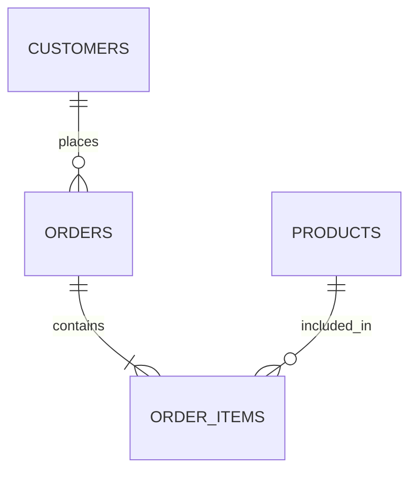
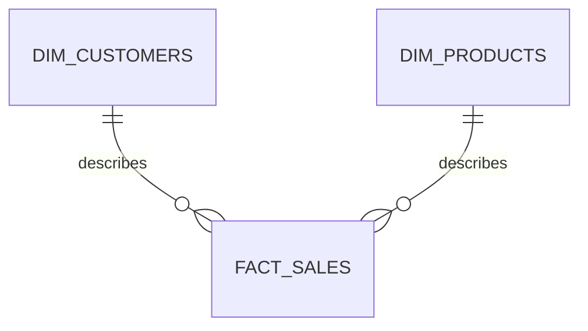
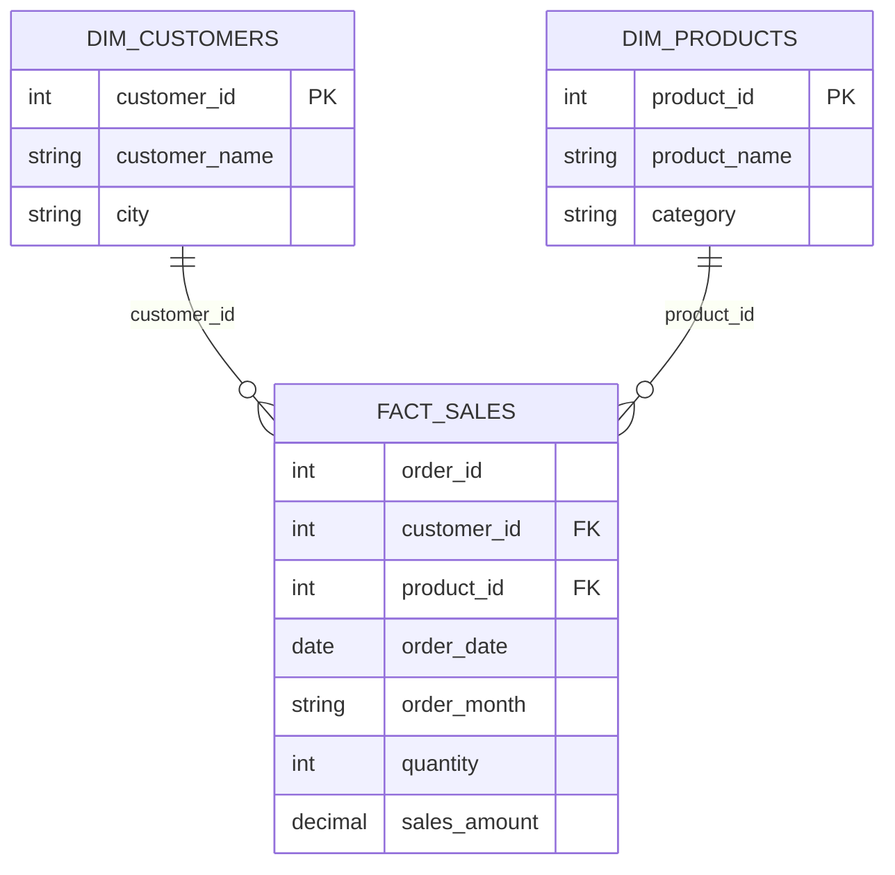

# Operational vs Analytical Data Modeling — MySQL 8 and PySpark

**Scenario:** An online store wants to run daily orders and also understand its sales.

**Goal:** Answer three business questions using an operational model, convert the data with PySpark, and answer the same questions using an analytical model.

**Tools:** MySQL 8, MySQL Workbench, and an existing PySpark shell (`spark` already available).

**How to work:** Run the MySQL setup once. Execute SQL statements in order in MySQL Workbench. Then run the PySpark blocks in order in the *same PySpark shell*. Solutions are directly below each task.

---

## 1. Why do we need two models?

**Operational model:** Stores and updates individual business records. Example: place an order, correct a delivery detail, or cancel an order.

**Analytical model:** Helps answer questions across many orders. Example: monthly revenue, most profitable categories, and sales by city.

| Question | Operational (OLTP) | Analytical (OLAP) |
|---|---|---|
| Main job | Record and change orders | Compare and summarize orders |
| Data design | Separate business entities | Facts and dimensions |
| Typical action | Find or update Order 2001 | Find monthly revenue |
| Typical workload | Many small reads and writes | Large reads and aggregations |
| Main priority | Accurate transactions | Easy and efficient reporting |

**Important:** A normalized model *can* answer analytical questions. Analytical modeling does not make the results more correct by itself. For large workloads, a separate analytical system, columnar storage such as Parquet, and prepared business measures make repeated reporting more practical. Heavy reports can compete with operational transactions for CPU, memory, disk, and connections; **a large SELECT does not automatically cause downtime**.

### Operational model



### Analytical model (star schema)



**Grain** means what one row represents:

- In `order_items`, one row = one product in one order.
- In `fact_sales`, one row = one product in **one confirmed order**.
- `dim_customers` and `dim_products` hold descriptive details; `fact_sales` holds measurable sales.

---

## Exercise 1 — Set up the operational database

### Task

Create the normalized MySQL model and load data for **12 customers, 8 products, 36 orders, and 84 order items**. All data is inside this document.

### SQL solution — MySQL 8

> **Safety:** This resets only tables in the `modeling_olap_lab` practice database. It does not change the earlier normalization-session database. Run it on a practice MySQL instance, not production.

```sql
CREATE DATABASE IF NOT EXISTS modeling_olap_lab;
USE modeling_olap_lab;

-- Reset the practice tables when repeating this session.
DROP TABLE IF EXISTS order_items;
DROP TABLE IF EXISTS orders;
DROP TABLE IF EXISTS products;
DROP TABLE IF EXISTS customers;

CREATE TABLE customers (
    customer_id INT PRIMARY KEY,
    customer_name VARCHAR(40) NOT NULL,
    city VARCHAR(40) NOT NULL
) ENGINE=InnoDB;

CREATE TABLE products (
    product_id INT PRIMARY KEY,
    product_name VARCHAR(50) NOT NULL,
    category VARCHAR(40) NOT NULL,
    current_price DECIMAL(10,2) NOT NULL
) ENGINE=InnoDB;

CREATE TABLE orders (
    order_id INT PRIMARY KEY,
    customer_id INT NOT NULL,
    order_date DATE NOT NULL,
    status VARCHAR(12) NOT NULL,
    CONSTRAINT fk_orders_customers
        FOREIGN KEY (customer_id) REFERENCES customers(customer_id)
) ENGINE=InnoDB;

CREATE TABLE order_items (
    order_id INT NOT NULL,
    product_id INT NOT NULL,
    quantity INT NOT NULL,
    unit_price_at_sale DECIMAL(10,2) NOT NULL,
    PRIMARY KEY (order_id, product_id),
    CONSTRAINT fk_items_orders
        FOREIGN KEY (order_id) REFERENCES orders(order_id),
    CONSTRAINT fk_items_products
        FOREIGN KEY (product_id) REFERENCES products(product_id)
) ENGINE=InnoDB;

INSERT INTO customers (customer_id, customer_name, city) VALUES
    (1, 'Riya', 'Pune'),
    (2, 'Amit', 'Mumbai'),
    (3, 'Neha', 'Pune'),
    (4, 'Rahul', 'Nashik'),
    (5, 'Sara', 'Bengaluru'),
    (6, 'Karan', 'Mumbai'),
    (7, 'Meera', 'Hyderabad'),
    (8, 'Arjun', 'Pune'),
    (9, 'Anita', 'Delhi'),
    (10, 'Dev', 'Bengaluru'),
    (11, 'Priya', 'Nashik'),
    (12, 'Kabir', 'Hyderabad');

INSERT INTO products (product_id, product_name, category, current_price) VALUES
    (101, 'Keyboard', 'Peripherals', 1500.00),
    (102, 'Mouse', 'Peripherals', 600.00),
    (103, 'USB Cable', 'Accessories', 250.00),
    (104, 'Laptop Stand', 'Accessories', 1000.00),
    (105, 'Monitor', 'Displays', 9000.00),
    (106, 'Webcam', 'Peripherals', 2200.00),
    (107, 'SSD', 'Storage', 3500.00),
    (108, 'Headphones', 'Audio', 1800.00);

INSERT INTO orders (order_id, customer_id, order_date, status) VALUES
    (2001, 1, '2026-08-02', 'CONFIRMED'),
    (2002, 6, '2026-08-04', 'CONFIRMED'),
    (2003, 11, '2026-08-06', 'CONFIRMED'),
    (2004, 4, '2026-08-08', 'CONFIRMED'),
    (2005, 9, '2026-08-10', 'CONFIRMED'),
    (2006, 2, '2026-08-12', 'PENDING'),
    (2007, 7, '2026-08-14', 'CONFIRMED'),
    (2008, 12, '2026-08-16', 'CONFIRMED'),
    (2009, 5, '2026-08-18', 'CANCELLED'),
    (2010, 10, '2026-08-20', 'CONFIRMED'),
    (2011, 3, '2026-08-22', 'CONFIRMED'),
    (2012, 8, '2026-08-24', 'CONFIRMED'),
    (2013, 1, '2026-09-02', 'CONFIRMED'),
    (2014, 6, '2026-09-04', 'CONFIRMED'),
    (2015, 11, '2026-09-06', 'CONFIRMED'),
    (2016, 4, '2026-09-08', 'CONFIRMED'),
    (2017, 9, '2026-09-10', 'PENDING'),
    (2018, 2, '2026-09-12', 'CONFIRMED'),
    (2019, 7, '2026-09-14', 'CONFIRMED'),
    (2020, 12, '2026-09-16', 'CONFIRMED'),
    (2021, 5, '2026-09-18', 'CONFIRMED'),
    (2022, 10, '2026-09-20', 'CONFIRMED'),
    (2023, 3, '2026-09-22', 'CONFIRMED'),
    (2024, 8, '2026-09-24', 'CANCELLED'),
    (2025, 1, '2026-10-02', 'CONFIRMED'),
    (2026, 6, '2026-10-04', 'CONFIRMED'),
    (2027, 11, '2026-10-06', 'CONFIRMED'),
    (2028, 4, '2026-10-08', 'PENDING'),
    (2029, 9, '2026-10-10', 'CONFIRMED'),
    (2030, 2, '2026-10-12', 'CONFIRMED'),
    (2031, 7, '2026-10-14', 'CONFIRMED'),
    (2032, 12, '2026-10-16', 'CANCELLED'),
    (2033, 5, '2026-10-18', 'CONFIRMED'),
    (2034, 10, '2026-10-20', 'CONFIRMED'),
    (2035, 3, '2026-10-22', 'CONFIRMED'),
    (2036, 8, '2026-10-24', 'CONFIRMED');

INSERT INTO order_items
    (order_id, product_id, quantity, unit_price_at_sale)
VALUES
    (2001, 101, 1, 1400.00), (2001, 103, 2, 250.00), (2001, 106, 3, 2200.00),
    (2002, 104, 2, 1000.00), (2002, 106, 3, 2200.00),
    (2003, 107, 3, 3500.00), (2003, 101, 1, 1500.00),
    (2004, 102, 1, 600.00), (2004, 104, 2, 1000.00), (2004, 107, 3, 3500.00),
    (2005, 105, 2, 9000.00), (2005, 107, 3, 3500.00),
    (2006, 108, 3, 1800.00), (2006, 102, 1, 600.00),
    (2007, 103, 1, 250.00), (2007, 105, 2, 8900.00), (2007, 108, 3, 1800.00),
    (2008, 106, 2, 2100.00), (2008, 108, 3, 1800.00),
    (2009, 101, 3, 1500.00), (2009, 103, 1, 250.00),
    (2010, 104, 1, 1000.00), (2010, 106, 2, 2200.00), (2010, 101, 3, 1500.00),
    (2011, 107, 2, 3500.00), (2011, 101, 3, 1500.00),
    (2012, 102, 3, 600.00), (2012, 104, 1, 1000.00),
    (2013, 105, 1, 9000.00), (2013, 107, 2, 3500.00), (2013, 102, 3, 500.00),
    (2014, 108, 2, 1800.00), (2014, 102, 3, 500.00),
    (2015, 103, 3, 200.00), (2015, 105, 1, 9000.00),
    (2016, 106, 1, 2200.00), (2016, 108, 2, 1800.00), (2016, 103, 3, 250.00),
    (2017, 101, 2, 1500.00), (2017, 103, 3, 250.00),
    (2018, 104, 3, 1000.00), (2018, 106, 1, 2200.00),
    (2019, 107, 1, 3500.00), (2019, 101, 2, 1500.00), (2019, 104, 3, 1000.00),
    (2020, 102, 2, 600.00), (2020, 104, 3, 1000.00),
    (2021, 105, 3, 9000.00), (2021, 107, 1, 3400.00),
    (2022, 108, 1, 1700.00), (2022, 102, 2, 600.00), (2022, 105, 3, 9000.00),
    (2023, 103, 2, 250.00), (2023, 105, 3, 9000.00),
    (2024, 106, 3, 2200.00), (2024, 108, 1, 1800.00),
    (2025, 101, 1, 1500.00), (2025, 103, 2, 250.00), (2025, 106, 3, 2200.00),
    (2026, 104, 2, 1000.00), (2026, 106, 3, 2200.00),
    (2027, 107, 3, 3500.00), (2027, 101, 1, 1500.00),
    (2028, 102, 1, 600.00), (2028, 104, 2, 900.00), (2028, 107, 3, 3500.00),
    (2029, 105, 2, 8900.00), (2029, 107, 3, 3500.00),
    (2030, 108, 3, 1800.00), (2030, 102, 1, 600.00),
    (2031, 103, 1, 250.00), (2031, 105, 2, 9000.00), (2031, 108, 3, 1800.00),
    (2032, 106, 2, 2200.00), (2032, 108, 3, 1800.00),
    (2033, 101, 3, 1500.00), (2033, 103, 1, 250.00),
    (2034, 104, 1, 1000.00), (2034, 106, 2, 2200.00), (2034, 101, 3, 1400.00),
    (2035, 107, 2, 3500.00), (2035, 101, 3, 1400.00),
    (2036, 102, 3, 500.00), (2036, 104, 1, 1000.00);

SELECT
    (SELECT COUNT(*) FROM customers) AS customers,
    (SELECT COUNT(*) FROM products) AS products,
    (SELECT COUNT(*) FROM orders) AS orders,
    (SELECT COUNT(*) FROM order_items) AS order_items;
```

**Expected:** `12 customers | 8 products | 36 orders | 84 order items`.

Only `CONFIRMED` orders count as sales in this session. `PENDING` and `CANCELLED` orders are excluded. Revenue uses **price at the time of sale**, not the product's current catalog price.

---

## Exercise 2 — Three business questions using operational tables

Each question requires reading multiple operational tables. The queries are correct; the difficulty is repeating this work over very large datasets while the same database serves customer transactions.

### Question 1 — What is the revenue for each month?

**SQL solution — MySQL 8**

```sql
SELECT DATE_FORMAT(o.order_date, '%Y-%m') AS order_month,
       SUM(i.quantity * i.unit_price_at_sale) AS revenue
FROM orders AS o
JOIN order_items AS i ON o.order_id = i.order_id
WHERE o.status = 'CONFIRMED'
GROUP BY DATE_FORMAT(o.order_date, '%Y-%m')
ORDER BY order_month;
```

**Expected result**

| Month | Revenue (₹) |
|---|---:|
| 2026-08 | 127,950.00 |
| 2026-09 | 145,450.00 |
| 2026-10 | 115,200.00 |

**Observation:** We join orders with items and calculate revenue every time.

### Question 2 — Which product categories earn the most revenue?

**SQL solution — MySQL 8**

```sql
SELECT p.category,
       SUM(i.quantity * i.unit_price_at_sale) AS revenue
FROM orders AS o
JOIN order_items AS i ON o.order_id = i.order_id
JOIN products AS p ON i.product_id = p.product_id
WHERE o.status = 'CONFIRMED'
GROUP BY p.category
ORDER BY revenue DESC, p.category;
```

**Expected result**

| Category | Revenue (₹) |
|---|---:|
| Displays | 170,600.00 |
| Peripherals | 84,500.00 |
| Storage | 80,400.00 |
| Audio | 30,500.00 |
| Accessories | 22,600.00 |

**Observation:** We now join three operational tables.

### Question 3 — Which cities generate the most revenue, and how many orders?

**SQL solution — MySQL 8**

```sql
SELECT c.city,
       SUM(i.quantity * i.unit_price_at_sale) AS revenue,
       COUNT(DISTINCT o.order_id) AS total_orders
FROM orders AS o
JOIN order_items AS i ON o.order_id = i.order_id
JOIN customers AS c ON o.customer_id = c.customer_id
WHERE o.status = 'CONFIRMED'
GROUP BY c.city
ORDER BY revenue DESC, c.city;
```

**Expected result**

| City | Revenue (₹) | Orders |
|---|---:|---:|
| Pune | 90,100.00 | 8 |
| Bengaluru | 84,550.00 | 5 |
| Hyderabad | 70,400.00 | 5 |
| Delhi | 56,800.00 | 2 |
| Nashik | 53,250.00 | 5 |
| Mumbai | 33,500.00 | 5 |

**Observation:** This report needs customers, orders, and order items. `COUNT(DISTINCT order_id)` is necessary: counting rows would count purchased products, not orders.

### What we have learned

These reports are possible in MySQL. They are not wrong or inherently slow. But as historical data grows, repeated joins, scans, and aggregations can consume resources on a system also handling live orders. A separate analytical model gives reports a dedicated design and a separate place to run.

---

## Exercise 3 — Extract MySQL data into PySpark

### Concept

**JDBC** lets PySpark read database tables. The transformation can then run outside the operational database.


### Before running PySpark

- Start the MySQL server and complete Exercise 1.
- Install MySQL Connector/J, then start the **PySpark shell** with its JAR on the classpath. Example for Windows PowerShell: `pyspark --jars "C:\jdbc\mysql-connector-j.jar"`. Replace the path with the **actual downloaded JAR file**. Restart the shell after adding the driver.
- The following example uses MySQL running on **the same computer** as PySpark. If MySQL is on another computer, change `127.0.0.1` to that computer's host name or IP address and allow access appropriately.
- Use a MySQL account that can read the practice database. Do not paste real passwords into shared documents.

### Task

Load all four operational tables into DataFrames.

### PySpark solution — run inside `pyspark`

```python
from getpass import getpass
from pyspark.sql import functions as F

jdbc_url = (
    "jdbc:mysql://127.0.0.1:3306/modeling_olap_lab"
    "?sslMode=DISABLED&allowPublicKeyRetrieval=true"
)
jdbc_user = input("MySQL username: ")
jdbc_password = getpass("MySQL password: ")

# For a local classroom database only. Use TLS for remote servers.
jdbc_options = {
    "url": jdbc_url,
    "user": jdbc_user,
    "password": jdbc_password,
    "driver": "com.mysql.cj.jdbc.Driver"
}

customers_df = spark.read.format("jdbc").options(
    **jdbc_options
).option("dbtable", "customers").load()

products_df = spark.read.format("jdbc").options(
    **jdbc_options
).option("dbtable", "products").load()

orders_df = spark.read.format("jdbc").options(
    **jdbc_options
).option("dbtable", "orders").load()

order_items_df = spark.read.format("jdbc").options(
    **jdbc_options
).option("dbtable", "order_items").load()

print("Customers:", customers_df.count())
print("Products:", products_df.count())
print("Orders:", orders_df.count())
print("Order items:", order_items_df.count())
```

**Expected:** `12, 8, 36, 84`.

**Note:** This is a small classroom extract. Reading very large production tables may require partitioned JDBC reads, incremental extraction, and source-friendly scheduling. The example does not demonstrate a production-grade ingestion strategy.

---

## Exercise 4 — Convert operational tables into an analytical model

### Concept

- **Dimension:** Describes a customer or a product. Examples: city and category.
- **Fact:** Records a measurable business event. Here, one row is a product sold in a confirmed order.
- **Measure:** A number used in reports. Here, `sales_amount = quantity × unit_price_at_sale`.

### Task

Build two dimensions and one sales fact DataFrame from the operational data.

### PySpark solution

```python
dim_customers_df = customers_df.select(
    "customer_id", "customer_name", "city"
)

dim_products_df = products_df.select(
    "product_id", "product_name", "category"
)

fact_sales_df = (
    orders_df.alias("o")
    .filter(F.col("o.status") == "CONFIRMED")
    .join(
        order_items_df.alias("i"),
        F.col("o.order_id") == F.col("i.order_id"),
        "inner"
    )
    .select(
        F.col("o.order_id").alias("order_id"),
        F.col("o.customer_id").alias("customer_id"),
        F.col("i.product_id").alias("product_id"),
        F.col("o.order_date").alias("order_date"),
        F.date_format("o.order_date", "yyyy-MM").alias("order_month"),
        F.col("i.quantity").alias("quantity"),
        F.col("i.unit_price_at_sale").alias("unit_price_at_sale"),
        (F.col("i.quantity") * F.col("i.unit_price_at_sale"))
            .cast("decimal(14,2)").alias("sales_amount")
    )
)

print("Dim customers:", dim_customers_df.count())
print("Dim products:", dim_products_df.count())
print("Fact sales rows:", fact_sales_df.count())

fact_sales_df.orderBy("order_id", "product_id").show(8, truncate=False)
```

**Expected:** 12 customers, 8 products, and **71 fact rows**.

The fact does not store repeated names and categories; those come from the dimensions. It already stores a ready-to-sum sales measure. **One order can create several fact rows**, so fact-row count is not order count.

### Analytical tables



---

## Exercise 5 — Answer the same three questions using the analytical model

### Task

Create temporary SQL views for the DataFrames. Then run the business questions again.

### PySpark solution — create views

```python
dim_customers_df.createOrReplaceTempView("dim_customers")
dim_products_df.createOrReplaceTempView("dim_products")
fact_sales_df.createOrReplaceTempView("fact_sales")
```

### Question 1 — Monthly revenue (no joins)

```python
spark.sql("""
SELECT order_month, SUM(sales_amount) AS revenue
FROM fact_sales
GROUP BY order_month
ORDER BY order_month
""").show(truncate=False)
```

**Expected:** Same monthly results as Exercise 2, Question 1.

### Question 2 — Revenue by category (one join)

```python
spark.sql("""
SELECT p.category, SUM(f.sales_amount) AS revenue
FROM fact_sales f
JOIN dim_products p ON f.product_id = p.product_id
GROUP BY p.category
ORDER BY revenue DESC, p.category
""").show(truncate=False)
```

**Expected:** Same category results as Exercise 2, Question 2.

### Question 3 — Revenue and orders by city (one join)

```python
spark.sql("""
SELECT c.city,
       SUM(f.sales_amount) AS revenue,
       COUNT(DISTINCT f.order_id) AS total_orders
FROM fact_sales f
JOIN dim_customers c ON f.customer_id = c.customer_id
GROUP BY c.city
ORDER BY revenue DESC, c.city
""").show(truncate=False)
```

**Expected:** Same city results as Exercise 2, Question 3.

### Compare the models

| Business query | Operational tables joined | Analytical tables joined |
|---|---:|---:|
| Monthly revenue | 2 tables | 1 fact table |
| Revenue by category | 3 tables | Fact + Product dimension |
| Revenue and orders by city | 3 tables | Fact + Customer dimension |

**What improved?** Reports now use a clear sales fact with a reusable measure and relevant dimensions. The examples need fewer joins and do not have to filter order statuses or calculate each line's revenue again.

**What did not magically improve?** Fewer joins and shorter SQL do **not** prove faster execution. Performance depends on the size of the data, hardware, indexing, storage format, partitioning, and query engine.

---

## Exercise 6 — Store and validate the analytical data

### Concept

**Parquet** is a column-oriented file format commonly used for analytics. It lets analytical engines read relevant columns without reading every field, subject to file layout and engine support.

### Task

Write the fact and dimensions to Parquet, read the fact back, and compare its total with the operational MySQL result.

### PySpark solution

```python
from pathlib import Path

# Local-file output; suitable for a local PySpark shell.
output_root = (Path.cwd() / "modeling_olap_output").resolve().as_uri()

dim_customers_df.write.mode("overwrite").parquet(
    output_root + "/dim_customers"
)
dim_products_df.write.mode("overwrite").parquet(
    output_root + "/dim_products"
)
fact_sales_df.write.mode("overwrite").parquet(
    output_root + "/fact_sales"
)

saved_fact_df = spark.read.parquet(output_root + "/fact_sales")

saved_fact_df.select(
    F.count("*").alias("sales_lines"),
    F.countDistinct("order_id").alias("confirmed_orders"),
    F.sum("sales_amount").alias("total_revenue")
).show(truncate=False)
```

**Expected:** `71 sales lines`, `30 confirmed orders`, and total revenue of **₹388,600.00**.

**Final check:** Sum the three monthly revenue values from Exercise 2. They must equal this total.

---

## Quick recap

| Operational model | Analytical model |
|---|---|
| Organizes entities for transactions | Organizes events and descriptions for reports |
| Updates individual orders reliably | Scans and summarizes many sales |
| Often normalized | Often uses facts and dimensions |
| Queries may join several source tables | Reuses measures at a clear fact grain |
| Good for running the business | Good for understanding the business |

**Remember:** The real benefit comes from **data modeling + ETL + analytical storage/compute**, not simply joining tables once. Operational and analytical systems serve different workloads, and both are useful.

### Documentation

- [Apache Spark JDBC data source](https://spark.apache.org/docs/latest/sql-data-sources-jdbc.html)
- [MySQL Connector/J](https://dev.mysql.com/doc/connector-j/en/)
- [PySpark DataFrameWriter — Parquet](https://spark.apache.org/docs/latest/api/python/reference/pyspark.sql/api/pyspark.sql.DataFrameWriter.parquet.html)
