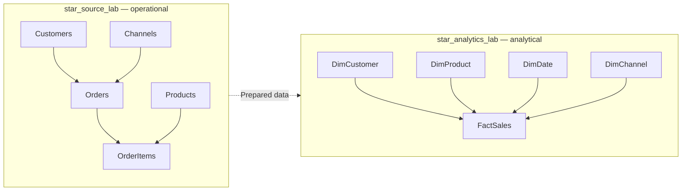
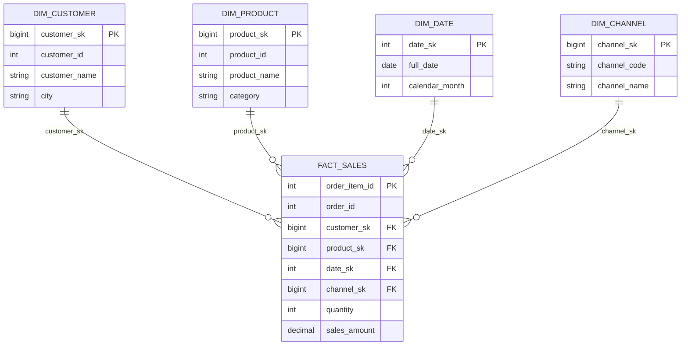
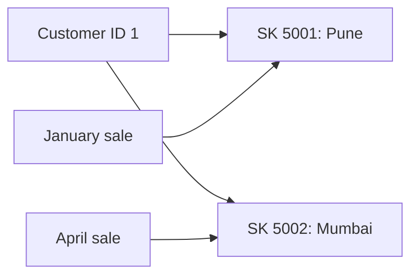

# Star Schema Data Modeling — Hands-on with MySQL 8

**Scenario:** An e-commerce store wants clearer sales reports.  
**Tools:** MySQL 8 and MySQL Workbench  
**Goal:** Choose the grain, facts, and dimensions of a star schema; understand its keys; and answer sales questions, including historical reporting.

## Learning path


The database is populated in **Exercise 1**. You do not need PySpark or an ETL pipeline for this lesson. The sample contains **12 customers, 8 products, 24 orders, and 48 order items**.

| Term | Simple meaning |
|---|---|
| **Fact** | Something that happened, such as an item being sold |
| **Dimension** | Information describing that event: customer, product, date, or channel |
| **Grain** | What exactly one fact row represents |
| **Measure** | A number we want to analyze, such as quantity or revenue |

---

## Exercise 1 — Understand the business problem and set up the data

### The situation

An online store takes orders through its website, shops, and partners. The business wants to answer three questions:

- How much did we sell each month?
- Which product categories earned the most revenue?
- Which customer cities contributed the most revenue?

The store already uses a normalized operational database. For reporting, it also has a **star schema** with one sales fact table and four dimensions. We will explore the prepared tables instead of rebuilding an ETL pipeline.

Only **CONFIRMED** orders count as sales. The saved item price is the price charged at the time of the order.

### Two connected databases



### Task — Run the setup

Run **the complete SQL block below once**, in MySQL Workbench, using a practice MySQL 8 server. It creates and fills both databases. The script only drops the listed practice tables, but it will replace any existing data in those tables.

**Important:** This is a reset script. Do not run it in a production database. You can run the later exercise queries one by one.

### SQL solution — complete setup

```sql
CREATE DATABASE IF NOT EXISTS star_source_lab;
CREATE DATABASE IF NOT EXISTS star_analytics_lab;

-- Prepare the operational tables.
USE star_source_lab;
DROP TABLE IF EXISTS order_items;
DROP TABLE IF EXISTS customer_city_events;
DROP TABLE IF EXISTS orders;
DROP TABLE IF EXISTS products;
DROP TABLE IF EXISTS channels;
DROP TABLE IF EXISTS customers;

CREATE TABLE customers (
    customer_id INT PRIMARY KEY,
    customer_name VARCHAR(60) NOT NULL,
    city VARCHAR(60) NOT NULL
) ENGINE=InnoDB;

CREATE TABLE products (
    product_id INT PRIMARY KEY,
    product_name VARCHAR(60) NOT NULL,
    category VARCHAR(60) NOT NULL
) ENGINE=InnoDB;

CREATE TABLE channels (
    channel_code VARCHAR(20) PRIMARY KEY,
    channel_name VARCHAR(40) NOT NULL
) ENGINE=InnoDB;

CREATE TABLE orders (
    order_id INT PRIMARY KEY,
    customer_id INT NOT NULL,
    order_date DATE NOT NULL,
    channel_code VARCHAR(20) NOT NULL,
    order_status VARCHAR(15) NOT NULL,
    FOREIGN KEY (customer_id) REFERENCES customers(customer_id),
    FOREIGN KEY (channel_code) REFERENCES channels(channel_code)
) ENGINE=InnoDB;

CREATE TABLE order_items (
    order_item_id INT PRIMARY KEY,
    order_id INT NOT NULL,
    product_id INT NOT NULL,
    quantity INT NOT NULL,
    unit_price DECIMAL(10,2) NOT NULL,
    FOREIGN KEY (order_id) REFERENCES orders(order_id),
    FOREIGN KEY (product_id) REFERENCES products(product_id)
) ENGINE=InnoDB;

-- Add the customer, product, order, and order-item records.
INSERT INTO customers (customer_id, customer_name, city) VALUES
(1,'Riya','Mumbai'), (2,'Amit','Bengaluru'),
(3,'Neha','Delhi'), (4,'Rahul','Jaipur'),
(5,'Priya','Hyderabad'), (6,'Karan','Pune'),
(7,'Sara','Kolkata'), (8,'Vikram','Mumbai'),
(9,'Meera','Chennai'), (10,'Ishaan','Surat'),
(11,'Anaya','Nagpur'), (12,'Dev','Ahmedabad');

INSERT INTO products (product_id, product_name, category) VALUES
(101,'Keyboard','Accessories'),
(102,'Mouse','Accessories'),
(103,'Monitor','Displays'),
(104,'Laptop Stand','Accessories'),
(105,'Webcam','Cameras'),
(106,'USB Cable','Accessories'),
(107,'SSD','Storage'),
(108,'Headphones','Audio');

INSERT INTO channels (channel_code, channel_name) VALUES
('WEB','Website'), ('STORE','Retail Store'), ('PARTNER','Partner Marketplace');

INSERT INTO orders (order_id,customer_id,order_date,channel_code,order_status) VALUES
(1001,1,'2026-01-05','WEB','CONFIRMED'),
(1002,2,'2026-01-09','STORE','CONFIRMED'),
(1003,3,'2026-01-12','WEB','CONFIRMED'),
(1004,4,'2026-01-20','PARTNER','CANCELLED'),
(1005,5,'2026-01-25','STORE','CONFIRMED'),
(1006,6,'2026-01-29','WEB','CONFIRMED'),
(1007,1,'2026-02-04','STORE','CONFIRMED'),
(1008,2,'2026-02-08','WEB','CONFIRMED'),
(1009,7,'2026-02-11','PARTNER','PENDING'),
(1010,8,'2026-02-18','WEB','CONFIRMED'),
(1011,9,'2026-02-23','STORE','CONFIRMED'),
(1012,10,'2026-02-27','WEB','CONFIRMED'),
(1013,1,'2026-03-03','PARTNER','CONFIRMED'),
(1014,2,'2026-03-07','WEB','CONFIRMED'),
(1015,11,'2026-03-11','STORE','CONFIRMED'),
(1016,12,'2026-03-16','WEB','CANCELLED'),
(1017,3,'2026-03-24','PARTNER','CONFIRMED'),
(1018,4,'2026-03-29','WEB','CONFIRMED'),
(1019,2,'2026-04-02','WEB','CONFIRMED'),
(1020,1,'2026-04-06','STORE','CONFIRMED'),
(1021,5,'2026-04-10','PARTNER','CONFIRMED'),
(1022,6,'2026-04-15','STORE','PENDING'),
(1023,7,'2026-04-20','WEB','CONFIRMED'),
(1024,8,'2026-04-26','PARTNER','CONFIRMED');

INSERT INTO order_items (order_item_id,order_id,product_id,quantity,unit_price) VALUES
(1,1001,101,1,2000.00),(2,1001,102,2,900.00),
(3,1002,103,1,15000.00),(4,1002,106,2,300.00),
(5,1003,104,1,1600.00),(6,1003,105,1,4500.00),
(7,1004,107,1,5500.00),(8,1004,102,1,900.00),
(9,1005,108,2,2500.00),(10,1005,106,3,300.00),
(11,1006,101,1,2000.00),(12,1006,107,1,5500.00),
(13,1007,102,1,900.00),(14,1007,103,1,15000.00),
(15,1008,105,2,4500.00),(16,1008,106,1,300.00),
(17,1009,104,1,1600.00),(18,1009,108,1,2500.00),
(19,1010,101,2,2000.00),(20,1010,102,1,900.00),
(21,1011,107,1,5500.00),(22,1011,108,1,2500.00),
(23,1012,103,1,15000.00),(24,1012,104,1,1600.00),
(25,1013,105,1,4500.00),(26,1013,108,1,2500.00),
(27,1014,101,1,2000.00),(28,1014,106,4,300.00),
(29,1015,102,3,900.00),(30,1015,104,1,1600.00),
(31,1016,103,1,15000.00),(32,1016,107,1,5500.00),
(33,1017,105,1,4500.00),(34,1017,106,2,300.00),
(35,1018,108,2,2500.00),(36,1018,101,1,2000.00),
(37,1019,107,1,5500.00),(38,1019,102,2,900.00),
(39,1020,103,1,15000.00),(40,1020,106,1,300.00),
(41,1021,104,2,1600.00),(42,1021,105,1,4500.00),
(43,1022,108,1,2500.00),(44,1022,107,1,5500.00),
(45,1023,101,1,2000.00),(46,1023,108,1,2500.00),
(47,1024,102,1,900.00),(48,1024,103,1,15000.00);

-- Create the analytical tables. Child tables are dropped first.
USE star_analytics_lab;
DROP TABLE IF EXISTS fact_sales_scd2;
DROP TABLE IF EXISTS fact_sales;
DROP TABLE IF EXISTS dim_customer_scd2;
DROP TABLE IF EXISTS dim_channel;
DROP TABLE IF EXISTS dim_date;
DROP TABLE IF EXISTS dim_product;
DROP TABLE IF EXISTS dim_customer;

CREATE TABLE dim_customer (
    customer_sk BIGINT PRIMARY KEY,
    customer_id INT NOT NULL UNIQUE,
    customer_name VARCHAR(60) NOT NULL,
    city VARCHAR(60) NOT NULL
) ENGINE=InnoDB;

CREATE TABLE dim_product (
    product_sk BIGINT PRIMARY KEY,
    product_id INT NOT NULL UNIQUE,
    product_name VARCHAR(60) NOT NULL,
    category VARCHAR(60) NOT NULL
) ENGINE=InnoDB;

CREATE TABLE dim_date (
    date_sk INT PRIMARY KEY,
    full_date DATE NOT NULL UNIQUE,
    calendar_year INT NOT NULL,
    calendar_month INT NOT NULL
) ENGINE=InnoDB;

CREATE TABLE dim_channel (
    channel_sk BIGINT PRIMARY KEY,
    channel_code VARCHAR(20) NOT NULL UNIQUE,
    channel_name VARCHAR(40) NOT NULL
) ENGINE=InnoDB;

CREATE TABLE fact_sales (
    order_item_id INT PRIMARY KEY,
    order_id INT NOT NULL,
    customer_sk BIGINT NOT NULL,
    product_sk BIGINT NOT NULL,
    date_sk INT NOT NULL,
    channel_sk BIGINT NOT NULL,
    quantity INT NOT NULL,
    unit_price DECIMAL(10,2) NOT NULL,
    sales_amount DECIMAL(14,2) NOT NULL,
    FOREIGN KEY (customer_sk) REFERENCES dim_customer(customer_sk),
    FOREIGN KEY (product_sk) REFERENCES dim_product(product_sk),
    FOREIGN KEY (date_sk) REFERENCES dim_date(date_sk),
    FOREIGN KEY (channel_sk) REFERENCES dim_channel(channel_sk)
) ENGINE=InnoDB;

-- Fixed training keys keep this one-time sample load easy to check.
INSERT INTO dim_customer (customer_sk, customer_id, customer_name, city)
SELECT 1000 + customer_id, customer_id, customer_name, city
FROM star_source_lab.customers;

INSERT INTO dim_product (product_sk, product_id, product_name, category)
SELECT 2000 + product_id, product_id, product_name, category
FROM star_source_lab.products;

INSERT INTO dim_channel (channel_sk, channel_code, channel_name)
SELECT CASE channel_code
           WHEN 'WEB' THEN 3001
           WHEN 'STORE' THEN 3002
           ELSE 3003
       END, channel_code, channel_name
FROM star_source_lab.channels;

INSERT INTO dim_date (date_sk, full_date, calendar_year, calendar_month)
SELECT DISTINCT
    CAST(DATE_FORMAT(order_date, '%Y%m%d') AS UNSIGNED),
    order_date, YEAR(order_date), MONTH(order_date)
FROM star_source_lab.orders;

-- A fact row represents one item from a CONFIRMED order.
INSERT INTO fact_sales
    (order_item_id, order_id, customer_sk, product_sk, date_sk,
     channel_sk, quantity, unit_price, sales_amount)
SELECT
    i.order_item_id, o.order_id,
    1000 + o.customer_id,
    2000 + i.product_id,
    CAST(DATE_FORMAT(o.order_date, '%Y%m%d') AS UNSIGNED),
    CASE o.channel_code
        WHEN 'WEB' THEN 3001
        WHEN 'STORE' THEN 3002
        ELSE 3003
    END,
    i.quantity, i.unit_price,
    i.quantity * i.unit_price
FROM star_source_lab.orders AS o
JOIN star_source_lab.order_items AS i ON o.order_id = i.order_id
WHERE o.order_status = 'CONFIRMED';

-- Prepare historical customer versions for the SCD Type 2 exercise.
CREATE TABLE dim_customer_scd2 (
    customer_sk BIGINT PRIMARY KEY,
    customer_id INT NOT NULL,
    customer_name VARCHAR(60) NOT NULL,
    city VARCHAR(60) NOT NULL,
    effective_from DATE NOT NULL,
    effective_to_exclusive DATE NOT NULL,
    is_current TINYINT NOT NULL,
    UNIQUE KEY uq_customer_version (customer_id, effective_from)
) ENGINE=InnoDB;

INSERT INTO dim_customer_scd2
    (customer_sk, customer_id, customer_name, city,
     effective_from, effective_to_exclusive, is_current)
VALUES
    (5001,1,'Riya','Pune','2026-01-01','2026-03-01',0),
    (5002,1,'Riya','Mumbai','2026-03-01','9999-12-31',1),
    (5003,2,'Amit','Chennai','2026-01-01','2026-04-01',0),
    (5004,2,'Amit','Bengaluru','2026-04-01','9999-12-31',1),
    (5005,3,'Neha','Delhi','2026-01-01','9999-12-31',1),
    (5006,4,'Rahul','Jaipur','2026-01-01','9999-12-31',1),
    (5007,5,'Priya','Hyderabad','2026-01-01','9999-12-31',1),
    (5008,6,'Karan','Pune','2026-01-01','9999-12-31',1),
    (5009,7,'Sara','Kolkata','2026-01-01','9999-12-31',1),
    (5010,8,'Vikram','Mumbai','2026-01-01','9999-12-31',1),
    (5011,9,'Meera','Chennai','2026-01-01','9999-12-31',1),
    (5012,10,'Ishaan','Surat','2026-01-01','9999-12-31',1),
    (5013,11,'Anaya','Nagpur','2026-01-01','9999-12-31',1),
    (5014,12,'Dev','Ahmedabad','2026-01-01','9999-12-31',1);

CREATE TABLE fact_sales_scd2 (
    order_item_id INT PRIMARY KEY,
    order_id INT NOT NULL,
    customer_sk BIGINT NOT NULL,
    product_sk BIGINT NOT NULL,
    date_sk INT NOT NULL,
    channel_sk BIGINT NOT NULL,
    quantity INT NOT NULL,
    unit_price DECIMAL(10,2) NOT NULL,
    sales_amount DECIMAL(14,2) NOT NULL,
    FOREIGN KEY (customer_sk) REFERENCES dim_customer_scd2(customer_sk),
    FOREIGN KEY (product_sk) REFERENCES dim_product(product_sk),
    FOREIGN KEY (date_sk) REFERENCES dim_date(date_sk),
    FOREIGN KEY (channel_sk) REFERENCES dim_channel(channel_sk)
) ENGINE=InnoDB;

-- Link each sale to the customer's version valid on the sale date.
INSERT INTO fact_sales_scd2
    (order_item_id, order_id, customer_sk, product_sk, date_sk,
     channel_sk, quantity, unit_price, sales_amount)
SELECT
    f.order_item_id, f.order_id, h.customer_sk, f.product_sk,
    f.date_sk, f.channel_sk, f.quantity, f.unit_price, f.sales_amount
FROM fact_sales AS f
JOIN dim_customer AS c ON f.customer_sk = c.customer_sk
JOIN dim_date AS d ON f.date_sk = d.date_sk
JOIN dim_customer_scd2 AS h
    ON h.customer_id = c.customer_id
   AND d.full_date >= h.effective_from
   AND d.full_date < h.effective_to_exclusive;
```

### Check the setup

```sql
USE star_analytics_lab;

SELECT
    (SELECT COUNT(*) FROM dim_customer) AS customers,
    (SELECT COUNT(*) FROM dim_product) AS products,
    (SELECT COUNT(*) FROM dim_date) AS dates,
    (SELECT COUNT(*) FROM dim_channel) AS channels,
    (SELECT COUNT(*) FROM fact_sales) AS sales_lines,
    (SELECT COUNT(*) FROM dim_customer_scd2) AS customer_versions,
    (SELECT COUNT(*) FROM fact_sales_scd2) AS historical_sales_lines;

SELECT SUM(sales_amount) AS total_revenue
FROM fact_sales;
```

**Expected:** 12 customers, 8 products, 24 dates, 3 channels, 40 sales lines, 14 customer versions, and 40 historical sales lines. Revenue: **₹170,900**.

For Exercises 2–7, use `star_analytics_lab` as the active database. If you open a new SQL editor tab, run `USE star_analytics_lab;` first.

---

## Exercise 2 — How do we choose the grain?

### The problem

An order may contain several products. If we keep only one row per order, we lose the ability to understand individual product sales unless we keep a separate item-level dataset.

**Grain means what one fact row represents.** Choose it based on the questions the business wants to answer.

| Possible grain | One row means | What can it answer? |
|---|---|---|
| Order-level | One complete order | Number of orders and order totals |
| **Order-item-level** | **One item line in an order** | **Product sales, quantity and order totals** |

### Task — Count orders and sales lines

```sql
USE star_analytics_lab;

SELECT COUNT(*) AS sales_lines,
       COUNT(DISTINCT order_id) AS orders
FROM fact_sales;

SELECT order_id, COUNT(*) AS product_lines
FROM fact_sales
WHERE order_id IN (1001, 1002)
GROUP BY order_id
ORDER BY order_id;
```

**Expected:** 40 lines from 20 confirmed orders. Orders `1001` and `1002` each have two product lines.

**Decision:** FactSales has **one row per confirmed order item**. Therefore, `COUNT(*)` counts lines; `COUNT(DISTINCT order_id)` counts orders.

---

## Exercise 3 — How do we choose the dimension tables?

### The idea

Dimensions help us describe sales. A business question often gives a clue: *revenue **by** month*, *sales **by** category*, *orders **by** channel*.

| Question | Dimension | Useful details |
|---|---|---|
| When did the sale happen? | DimDate | Date, year, month |
| Who bought the product? | DimCustomer | Customer name, city |
| What was sold? | DimProduct | Product name, category |
| Where did the order come from? | DimChannel | Website, store, partner |

### Task — Explore the prepared dimensions

```sql
SELECT * FROM dim_customer ORDER BY customer_id LIMIT 5;
SELECT * FROM dim_product ORDER BY product_id LIMIT 5;
SELECT * FROM dim_date ORDER BY full_date LIMIT 5;
SELECT * FROM dim_channel ORDER BY channel_sk;
```

**Observe:** Each dimension has one row per descriptive member in this starting model. The date dimension has one row per date found in the example orders.

**Design choice:** We do not need a separate dimension for every column. `order_id` can stay in FactSales as a **degenerate dimension**, because the business may filter by order number without needing a whole DimOrder table.

---

## Exercise 4 — What belongs in the fact table?

### The idea

FactSales stores the **sale event**, keys that describe it, and numbers we can measure.

| Column | Purpose |
|---|---|
| `order_item_id` | Unique ID of the sale line; defines the fact row |
| `order_id` | Source order number |
| `customer_sk`, `product_sk`, `date_sk`, `channel_sk` | Link the sale to its dimensions |
| `quantity` | Number of units sold |
| `unit_price` | Price of one unit at purchase time |
| `sales_amount` | `quantity × unit_price` |

A **business key** comes from the source system, such as `customer_id = 1`. A **surrogate key** identifies a row in the analytical dimension, such as `customer_sk = 1001`. The two keys may be different; a historical dimension can have several surrogate keys for one business key.

### Task — Inspect a real sale

```sql
SELECT f.order_item_id, f.order_id,
       f.customer_sk, c.customer_id,
       f.product_sk, p.product_id, p.product_name,
       f.quantity, f.unit_price, f.sales_amount
FROM fact_sales AS f
JOIN dim_customer AS c ON f.customer_sk = c.customer_sk
JOIN dim_product AS p ON f.product_sk = p.product_sk
WHERE f.order_id = 1001
ORDER BY f.order_item_id;

SELECT order_id,
       SUM(quantity) AS units_sold,
       SUM(sales_amount) AS order_revenue
FROM fact_sales
WHERE order_id = 1001
GROUP BY order_id;
```

**Expected:** Order `1001` contains a keyboard and two mice: **3 units**, total revenue **₹3,800**.

**Important:** Revenue and quantity are additive. Unit price is not a useful total by itself; summing unit prices does not give revenue.

---

## Exercise 5 — How does the star schema work as one model?

### The idea

The fact table sits in the center. Each dimension adds useful descriptions when a report needs them.



### Task — Reconstruct a sale with its descriptions

```sql
SELECT f.order_id, d.full_date,
       c.customer_name, c.city,
       p.product_name, p.category,
       h.channel_name, f.quantity, f.sales_amount
FROM fact_sales AS f
JOIN dim_customer AS c ON f.customer_sk = c.customer_sk
JOIN dim_product AS p ON f.product_sk = p.product_sk
JOIN dim_date AS d ON f.date_sk = d.date_sk
JOIN dim_channel AS h ON f.channel_sk = h.channel_sk
WHERE f.order_id = 1001
ORDER BY f.order_item_id;
```

**Expected:** Two rows showing Riya's order on **2026-01-05**, placed through the **Website**. The city shown here is her **current city, Mumbai**.

A star schema gives each measure a clear grain and a consistent set of descriptions. In this lesson, both models run on MySQL, so this is a modeling exercise rather than a speed benchmark.

---

## Exercise 6 — Answer three business questions

### Question A — How much did we sell each month?

```sql
SELECT d.calendar_year, d.calendar_month,
       COUNT(DISTINCT f.order_id) AS orders,
       SUM(f.sales_amount) AS revenue
FROM fact_sales AS f
JOIN dim_date AS d ON f.date_sk = d.date_sk
GROUP BY d.calendar_year, d.calendar_month
ORDER BY d.calendar_year, d.calendar_month;
```

| Month (2026) | Orders | Revenue (₹) |
|---|---:|---:|
| January | 5 | 38,900 |
| February | 5 | 54,700 |
| March | 5 | 26,600 |
| April | 5 | 50,700 |
| **Total** | **20** | **170,900** |

### Question B — Which categories sold the most?

```sql
SELECT p.category, SUM(f.sales_amount) AS revenue
FROM fact_sales AS f
JOIN dim_product AS p ON f.product_sk = p.product_sk
GROUP BY p.category
ORDER BY revenue DESC;
```

| Category | Revenue (₹) |
|---|---:|
| Displays | 75,000 |
| Accessories | 34,900 |
| Cameras | 27,000 |
| Audio | 17,500 |
| Storage | 16,500 |

### Question C — Which current customer cities earned the most?

```sql
SELECT c.city, SUM(f.sales_amount) AS revenue
FROM fact_sales AS f
JOIN dim_customer AS c ON f.customer_sk = c.customer_sk
GROUP BY c.city
ORDER BY revenue DESC;
```

**Expected top three:** Mumbai **₹62,800**, Bengaluru **₹35,400**, Surat **₹16,600**.

These reports use the same fact table. Only the dimension changes according to the business question.

### Quick comparison — Operational vs Star Schema

The table below compares the **same three reports**, using the queries from our e-commerce model.

| Business question | Operational tables used | Tables / JOINs | Star Schema tables used | Tables / JOINs |
|---|---|---|---|---|
| Monthly revenue | Orders + OrderItems | 2 / 1 | FactSales + DimDate | 2 / 1 |
| Revenue by product category | Orders + OrderItems + Products | 3 / 2 | FactSales + DimProduct | 2 / 1 |
| Revenue by current customer city | Orders + OrderItems + Customers | 3 / 2 | FactSales + DimCustomer | 2 / 1 |

**What changed?** `FactSales` already stores confirmed sales lines and their calculated amounts. The report joins only the dimension needed for that question.

**Remember:** Fewer JOINs can make reporting queries easier to write and maintain, but do not automatically mean faster performance. Data size, indexes, database engine, and query plans also matter.

---

## Exercise 7 — How does SCD Type 2 change historical reporting?

### The problem

Riya lived in Pune before **1 March 2026**, then moved to Mumbai. Amit lived in Chennai before **1 April 2026**, then moved to Bengaluru. If every older sale uses their **current** city, past city reports can be misleading.

**SCD Type 2 keeps a separate dimension row for each recorded version.** `fact_sales_scd2` has already been loaded with the correct historical `customer_sk` for each sale date.



### Task A — Inspect the customer versions

```sql
SELECT customer_sk, customer_id, customer_name, city,
       effective_from, effective_to_exclusive, is_current
FROM dim_customer_scd2
WHERE customer_id IN (1, 2)
ORDER BY customer_id, effective_from;
```

| Customer | Historical versions |
|---|---|
| Riya | Pune until 2026-03-01; Mumbai from 2026-03-01 |
| Amit | Chennai until 2026-04-01; Bengaluru from 2026-04-01 |

`effective_to_exclusive` means that the ending date does **not** belong to the older version. An order on the change date uses the newer version.

### Task B — Check the city recorded for Riya's sales

```sql
SELECT f.order_id, d.full_date, c.city,
       SUM(f.sales_amount) AS revenue
FROM fact_sales_scd2 AS f
JOIN dim_customer_scd2 AS c ON f.customer_sk = c.customer_sk
JOIN dim_date AS d ON f.date_sk = d.date_sk
WHERE c.customer_id = 1
GROUP BY f.order_id, d.full_date, c.city
ORDER BY d.full_date;
```

**Expected:** Orders `1001` and `1007` show **Pune**; orders `1013` and `1020` show **Mumbai**.

### Task C — Compare the city reports

**Current customer city:**

```sql
SELECT c.city, SUM(f.sales_amount) AS revenue
FROM fact_sales AS f
JOIN dim_customer AS c ON f.customer_sk = c.customer_sk
GROUP BY c.city
ORDER BY c.city;
```

**City at the time of each sale:**

```sql
SELECT c.city, SUM(f.sales_amount) AS revenue
FROM fact_sales_scd2 AS f
JOIN dim_customer_scd2 AS c ON f.customer_sk = c.customer_sk
GROUP BY c.city
ORDER BY c.city;
```

| City | Current-city report (₹) | Historical-city report (₹) |
|---|---:|---:|
| Pune | 7,500 | 27,200 |
| Mumbai | 62,800 | 43,100 |
| Chennai | 8,000 | 36,100 |
| Bengaluru | 35,400 | 7,300 |

Other cities do not change. **Total revenue remains ₹170,900** in both reports; only the city assigned to some sales changes.

### Final check — Reconcile the two fact tables

```sql
SELECT 'CURRENT' AS model, COUNT(*) AS sale_lines,
       SUM(sales_amount) AS revenue
FROM fact_sales
UNION ALL
SELECT 'SCD2', COUNT(*), SUM(sales_amount)
FROM fact_sales_scd2;
```

**Expected:** Both have **40 rows** and **₹170,900** revenue.

---

## Quick recap

| Decision | Question to ask | Our choice |
|---|---|---|
| Business process | What event are we analyzing? | Confirmed product sales |
| Grain | What does one fact row mean? | One order item |
| Dimensions | How do we describe each sale? | Customer, Product, Date, Channel |
| Measures | Which numbers matter? | Quantity, Unit Price, Sales Amount |
| Keys | How do facts connect to descriptions? | Dimension surrogate keys |
| History | Which customer version belongs to a past sale? | Customer SCD Type 2 row valid on the sale date |

**Remember:** A **fact** tells us *what happened and how much*. A **dimension** tells us *who, what, where, or when*. The **grain** tells us what one fact row represents.
